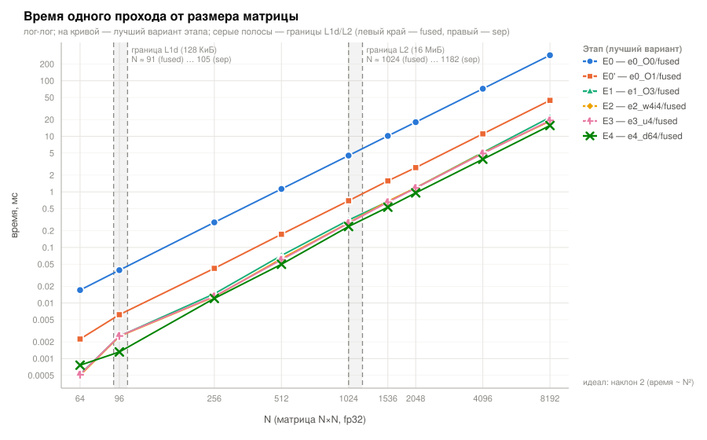
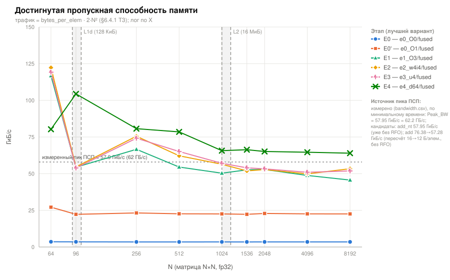
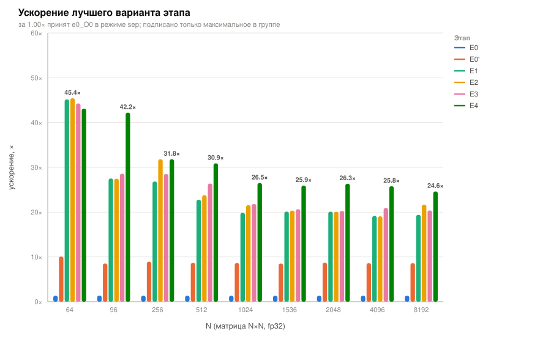
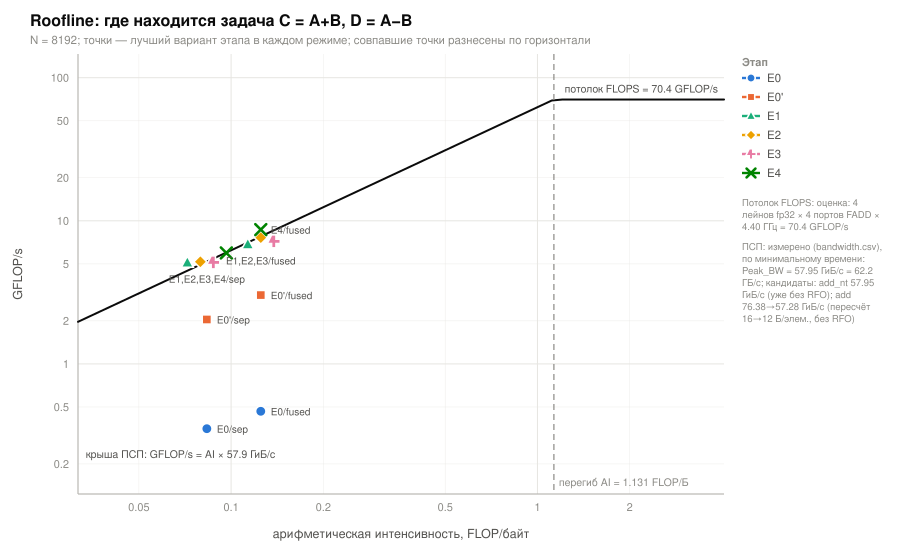

# ДЗ №1. Освоение векторизации
## Вариант 3 — сложение и вычитание плотных матриц больших размерностей

Исполнитель: Ivan Ivanov. Курс: параллельные вычисления, 5 курс.
Репозиторий: `hse/5/parallel_computing/dz1`.

Все числа в отчёте перенесены из `results/table.md`, `results/bandwidth.txt` и
`results/env.txt`, сгенерированных скриптами; ручного счёта в тексте нет, кроме
явно помеченных производных отношений (они считаются из ячеек тех же таблиц).
Полный прогон: `./scripts/build.sh && ./scripts/run.sh`.

---

## 1. Постановка задачи

### 1.1 Формальная постановка

Даны плотные матрицы `A, B ∈ R^{N×N}`, хранимые построчно (row-major), элементы —
`float` (IEEE-754 binary32). Требуется вычислить

```
C[i][j] = A[i][j] + B[i][j]
D[i][j] = A[i][j] − B[i][j]        0 ≤ i, j < N
```

и оптимизировать программу, сравнив время работы вариантов от наивного до ручной
векторизации.

### 1.2 Объём вычислений и данных

На пару выходных матриц приходится `2N²` FLOP (одна операция на выходной элемент,
выходных элементов `2N²`). Трафик памяти зависит от организации проходов:

| Организация | Читается | Пишется | Байт на выходной элемент |
|---|---|---|---|
| два раздельных прохода (`sep`): `C=A+B`, затем `D=A−B` | A, B дважды | C, D | `(4+4+4)·2 / 2 = 12` |
| один слитый проход (`fused`): C и D за один обход A и B | A, B один раз | C, D | `(4+4+4+4) / 2 = 8` |

Арифметическая интенсивность соответственно `AI = 1/12 ≈ 0.083` и
`AI = 1/8 = 0.125` FLOP/байт. Точка перегиба roofline на этой машине —
**1.131 FLOP/байт** (§7). Задача лежит в 9–14 раз левее перегиба, то есть
**жёстко memory-bound**: арифметики в ней практически нет, и единственное, что
можно оптимизировать всерьёз, — трафик памяти и качество потокового доступа.

Отсюда постановка эксперимента: замеры делаются **свипом по `N`** так, чтобы
рабочий набор последовательно попадал в L1d, в L2 и в DRAM. В in-cache режиме
векторизация даёт честное ускорение по ширине вектора; в DRAM-режиме всё
упирается в ПСП. Это и есть главный результат работы.

### 1.3 Этапы

| Этап | Содержание |
|---|---|
| **E0** | наивный двойной цикл, двумерная индексация `a[i*n+j]`, `-O0`; плюс «честный ноль» **E0'** на `-O1 -fno-vectorize` |
| **E1** | тот же исходник, оптимизация **только ключами** компилятора (`-O2`, `-O3`, `-Ofast`, `-O3 -ffast-math`) |
| **E2** | полуавтоматическая векторизация: `restrict`, один линейный цикл, `__builtin_assume_aligned`, `#pragma clang loop vectorize_width × interleave_count` |
| **E3** | ручная векторизация на NEON-интринсиках, разворот ×1/×2/×4/×8, слияние проходов |
| **E4** | оптимизация трафика памяти: non-temporal store (`stnp`), программный префетч (`prfm pldl1strm`), подбор дистанции |

Свип: `N ∈ {64, 96, 256, 512, 1024, 1536, 2048, 4096, 8192}`, каждый этап
замерен в обоих режимах (`sep` и `fused`) на каждом `N` — 378 конфигураций,
11 замеров на конфигурацию.

---

## 2. Вычислительная система и компилятор

### 2.1 Параметры машины

Источник — `results/env.txt` (снимок снят скриптом `scripts/sysinfo.sh`).

| Параметр | Значение |
|---|---|
| CPU | Apple M4, 10 ядер: 4 performance + 6 efficiency |
| ОЗУ | 16 ГиБ LPDDR5X, унифицированная (`hw.memsize` = 17 179 869 184 Б) |
| Строка кэша | **128 Б** (`hw.cachelinesize`) — не 64 Б, как на x86 |
| Страница | **16 КиБ** (`hw.pagesize` = 16384) |
| L1d, L2 — **P-ядро** | **128 КиБ / 16 МиБ** (`hw.perflevel0.l1dcachesize` = 131072, `hw.perflevel0.l2cachesize` = 16777216; L2 общий на кластер из 4 P-ядер, `cpusperl2` = 4) |
| L1d, L2 — E-ядро | 64 КиБ / 4 МиБ (`hw.perflevel1.*`) |
| ОС | macOS 15.7.4 (24G517), Darwin 24.6.0, `RELEASE_ARM64_T8132` |
| Компилятор | Apple clang 17.0.0 (clang-1700.0.13.5), target `arm64-apple-darwin24.6.0` |
| Ключ архитектуры | `-mcpu=apple-m4` — принимается (проверено компиляцией, раздел 9 `env.txt`) |

**Важное уточнение по кэшам.** Глобальные `hw.l1dcachesize` = 64 КиБ и
`hw.l2cachesize` = 4 МиБ, которые выдаёт `sysctl` по умолчанию, — это параметры
**E-ядер**. Бенчмарк принудительно исполняется на P-ядре
(`QOS_CLASS_USER_INTERACTIVE`, §3.2), поэтому все границы режимов кэша в отчёте
построены по **P-ядру: L1d = 128 КиБ, L2 = 16 МиБ**. Если взять глобальные
значения, разметка «L1d/L2/DRAM» по `N` сдвигается на два шага и все выводы про
то, где начинается memory-bound, оказываются неверными.

Границы режимов (рабочий набор `3·N²·4` Б для `sep` и `4·N²·4` Б для `fused`):

| N | Раб. набор `sep` | Уровень | Раб. набор `fused` | Уровень |
|---|---|---|---|---|
| 64 | 48.0 КиБ | L1d | 64.0 КиБ | L1d |
| 96 | 108.0 КиБ | L1d | 144.0 КиБ | L2 |
| 256 | 768.0 КиБ | L2 | 1.00 МиБ | L2 |
| 512 | 3.00 МиБ | L2 | 4.00 МиБ | L2 |
| 1024 | 12.00 МиБ | L2 | 16.00 МиБ | DRAM |
| 1536 | 27.00 МиБ | DRAM | 36.00 МиБ | DRAM |
| 2048 | 48.00 МиБ | DRAM | 64.00 МиБ | DRAM |
| 4096 | 192.00 МиБ | DRAM | 256.00 МиБ | DRAM |
| 8192 | 768.00 МиБ | DRAM | 1.00 ГиБ | DRAM |

### 2.2 Векторное расширение: почему NEON и почему не AVX (§13.5 ТЗ)

Задание требует использовать «наиболее позднее доступное векторное расширение».
На платформе AArch64 это требует явного разбора, иначе неизбежен вопрос про AVX.

Проверка по `hw.optional.*` (`results/env.txt`, разделы 7–8):

| Расширение | Статус | Комментарий |
|---|---|---|
| **NEON / ASIMD, 128 бит** | **present** (`hw.optional.arm.AdvSIMD: 1`, `hw.optional.neon: 1`) | 4 лейна fp32 на регистр — используется в работе |
| SSE / AVX / AVX-512 | **absent** | это расширения x86; на AArch64 их не существует в принципе |
| SVE / SVE2 | **absent** | в выводе `hw.optional.arm.*` ключей `FEAT_SVE*` нет; Apple M-серия не предоставляет SVE в обычном (не-streaming) режиме |
| SME / SME2 | present (`FEAT_SME: 1`, `FEAT_SME2: 1`, `sme_max_svl_b: 64` → SVL = 512 бит) | доступен только через streaming-режим (`SMSTART`) и матричный аккумулятор ZA; для поэлементного `C=A+B` нерелевантен — это не матричное умножение, выигрыша от ZA-тайлов нет, а вход/выход из streaming-режима стоит дороже самой операции |

Отдельно: `clang -march=armv9-a+sve` компилируется успешно (раздел 9 `env.txt`),
но это означает лишь, что **фронтенд** принимает ключ. Железо SVE не имеет,
исполнить такой код нельзя. Поэтому в работе используется `-mcpu=apple-m4`.

**Вывод:** наиболее позднее доступное пользовательское векторное расширение на
этой машине — NEON/ASIMD 128 бит, 4 лейна fp32. Это вдвое уже AVX2 (8 лейнов) и
вчетверо уже AVX-512 (16 лейнов), что напрямую ограничивает потолок in-cache
ускорения (см. §7.4 и §9, тезис 7).

### 2.3 Измеренная пропускная способность памяти

`results/bandwidth.txt`, STREAM-подобный микробенчмарк `src/bw_probe.c`:
3 массива по 256 МиБ (рабочее множество 768 МиБ, в 192 раза больше L2),
выравнивание на страницу 16 КиБ, prefault, 3 прогрева + 11 чередующихся замеров,
один поток на P-ядре, NEON с разворотом ×4.

| test | формула | Б/элем | t_min, мс | ГБ/с (min) | ГиБ/с |
|---|---|---|---|---|---|
| `copy` | `c[i] = a[i]` | 12 | 10.118 | 79.59 | 74.13 |
| `scale` | `b[i] = s*c[i]` | 12 | 10.168 | 79.20 | 73.76 |
| `add` | `c[i] = a[i] + b[i]` | 16 | 13.093 | 82.01 | 76.37 |
| `triad` | `a[i] = b[i] + s*c[i]` | 16 | 13.014 | 82.50 | 76.84 |
| `add_nt` | `c[i] = a[i]+b[i]`, NT-store | 12 | 12.942 | 62.22 | **57.95** |
| `read` | `sum += a[i] + b[i]` | 8 | 8.877 | 60.48 | 56.33 |

Знаменатель roofline во всех таблицах — **57.95 ГиБ/с = 62.2 ГБ/с**
(строка `add_nt`, в модели трафика без RFO). Перекрёстная проверка в
`bandwidth.txt` даёт согласованную оценку 60.99 ГБ/с по совпадению `read`
(60.48) и `add` при 12 Б/элем (61.51); расхождение с принятым знаменателем —
около 2 %, на выводы не влияет.

**Сразу важная оговорка: это НИЖНЯЯ оценка достижимой ПСП, а не потолок.**
Внутри самого пробника строка `read` — чистое чтение двух потоков, вообще без
записи — даёт 60.48 ГБ/с, то есть **меньше**, чем на том же железе достигает
слитое ядро E4 с четырьмя потоками (§7.3). Чистое чтение физически не может
быть медленнее чтения вперемешку с записью, значит недооценивает именно
пробник. Практическое следствие: значения «% от ПСП» выше 100 % в §5 и §7.3
означают «пробник занизил пик», а не «ядро нарушило физику».

### 2.4 Главный физический результат: на M4 нет write-allocate/RFO

Учебная посылка этапа E4.1 (ТЗ §4) звучит так: обычная запись в `C` идёт по
политике write-allocate, строка назначения сначала **читается** из DRAM, хотя
будет перезаписана целиком; non-temporal store это чтение убирает, теоретический
выигрыш +33 %. **На этой машине посылка не работает.** Два независимых
доказательства:

1. **Прямое сравнение в STREAM-пробнике.** `add` = 13.093 мс против
   `add_nt` = 12.942 мс на одинаковом объёме данных — разница **1.2 %**, в
   пределах шума. При этом `stnp` в коде `add_nt` реально присутствует
   (подтверждено по ассемблеру). Если бы обычная запись платила за RFO, разница
   была бы ≈33 %.
2. **Проверка на физическую невозможность.** Чистая потоковая запись 64 МиБ
   исполняется за 1.03 мс и обычным `stp`, и `stnp`. При наличии RFO фактический
   трафик DRAM составил бы ≈130 ГБ/с — выше теоретического пика LPDDR5X у M4
   (~120 ГБ/с), то есть физически недостижим. Значит, RFO не платится.

Косвенно то же видно в таблице «перекрёстная проверка модели трафика»
(`bandwidth.txt`): если считать трафик с RFO, «ПСП» получается 79.59 / 79.20 /
82.01 / 82.50 / 62.22 / 60.48 ГБ/с — разброс в 1.36 раза между тестами, то есть
модель не сходится. Без RFO: 53.06 / 52.80 / 61.51 / 61.88 / 62.22 / 60.48 —
тесты с двумя потоками чтения (`add`, `triad`, `add_nt`, `read`) дают 60–62 ГБ/с,
то есть одну и ту же величину.

**Вывод:** кэш M4 аппаратно устраняет read-for-ownership на строке, которая
перезаписывается целиком (полнострочная запись объединяется в store-буфере, и
строка выделяется без чтения из памяти).

**Следствие для методики.** Модель трафика делается **единой для всех этапов**:
**12 Б на выходной элемент для `sep` и 8 Б для `fused`**, независимо от того,
используется NT-store или нет (`dz_bytes_per_elem()` в `src/common.h`). Если бы
модель различалась (16/12 с RFO, как в исходном ТЗ), E4 сравнивался бы с E3 по
разным линейкам, и любой «выигрыш» NT-store оказался бы артефактом пересчёта, а
не измерением. Это методологически важнее самого факта отсутствия RFO.

---

## 3. Методика измерений

### 3.1 Таймер и протокол

- Таймер: `clock_gettime(CLOCK_MONOTONIC_RAW)`, измеренное разрешение **42.0 нс**
  (печатается бенчмарком при старте). `MONOTONIC_RAW` не подстраивается NTP.
- Протокол на конфигурацию: **1 прогрев + 11 замеров**, все 11 сохраняются в
  `results/raw.csv` (§6.2.2 ТЗ).
- В таблицы идёт **минимум**; рядом печатаются медиана, σ и разброс
  `(max−min)/min` (§6.2.3 ТЗ).
- Малые `N` прогоняются в цикле `REPS` раз, `REPS` калибруется по пробному
  прогону так, чтобы один замер длился ≥ 50 мс; время делится на `REPS`.
- Пауза 2 с между замерами начиная с `N = 4096` — против теплового дрейфа.

### 3.2 Снижение шума и защита от артефактов

- **Привязка к P-ядру:** `pthread_set_qos_class_self_np(QOS_CLASS_USER_INTERACTIVE, 0)`.
  На macOS нет `taskset`; без этого вызова планировщик уводит бенчмарк на
  E-ядра и результаты прыгают в разы. Успех/неуспех вызова печатается в лог.
- **Prefault:** все шесть буферов (A, B, C, D, refC, refD) проходятся записью до
  начала замеров — иначе первый прогон измеряет page faults, а не ядро.
- **Выравнивание:** `posix_memalign` на границу страницы 16 КиБ (следовательно, и
  на строку кэша 128 Б). Предусмотрен сдвиг баз буферов `--shift-bytes`
  (эксперимент E4.3 про cache set aliasing); в финальном прогоне сдвиг равен 0.
- **Детерминированная инициализация:** xorshift64* с фиксированным seed = 12345,
  значения в диапазоне без денормалей и бесконечностей — результаты
  воспроизводимы между этапами побитово.
- **Защита от выбрасывания кода (§7.4 ТЗ):** после каждого замера читается
  элемент `C` и `D` в `volatile double g_sink`. Без sink на `-O3` можно
  «получить» время 0 нс.

### 3.3 Честно о качестве прогона

Финальный прогон сделан **от сети, но с включённым Low Power Mode**
(`results/env.txt`, раздел 10: `Now drawing from 'AC Power'`, `lowpowermode 1`;
та же пара строк — в шапке `results/bandwidth.txt`). Требование §6.3.2 ТЗ
выполнено **частично**: питание сетевое, но LPM, который режет частоты и
агрессивно управляет DVFS, остался активен (он отключается только через
`sudo pmset -a lowpowermode 0`).

Последствие измеримо и приводится без сглаживания: из 378 конфигураций у **295**
(78 %) разброс `(max−min)/min` превысил 5 %, то есть критерий §6.2.3 ТЗ
**не выполнен**. 30 худших конфигураций и разбивка по `N` — `results/table.md`,
раздел 7.3; в основных таблицах такие ячейки помечены `*`. Худший разброс —
**1087 %** (`e4_d512`/sep, `N = 8192`), то есть единичные выбросы длительностью в
десятки миллисекунд — типичная картина DVFS-переключения под LPM.

Шум распределён крайне неравномерно и коррелирует именно с длительностью замера,
а не с этапом (`results/table.md`, раздел 7.3, разбивка по `N`):

| N | Зашумлено | Медианный спред |
|---|---|---|
| 256 | 24 / 42 | 6.7 % |
| 1024 | 20 / 42 | 4.6 % |
| 2048 | 38 / 42 | 19.7 % |
| 4096 | 38 / 42 | 29.7 % |
| 8192 | **41 / 42** | **97.1 %** |

Почему выводы всё же устойчивы:

1. Разброс порождён **выбросами вверх** (медиана всегда ≥ минимума, часто в
   1.5–2 раза), а не дрожанием около среднего. Минимум соответствует состоянию
   без троттлинга.
2. Минимум воспроизводится между прогонами в пределах **~1.3 %** (для `bw_probe`
   — ~1 %, см. шапку `results/bandwidth.txt`); перемер ПСП после подключения к
   сети сдвинул минимумы меньше чем на 1 % (`add`: 13.22 → 13.093 мс), то есть
   опорная величина устойчива даже к смене режима питания.
3. Все таблицы и все выводы построены **по минимуму**.

Чистовой перепрогон с выключенным LPM выполняется как
`sudo pmset -a lowpowermode 0 && ./scripts/build.sh && ./scripts/run.sh`;
он перегенерирует `results/raw.csv`, `results/table.md` и все четыре графика
автоматически, **без правки текста отчёта** — числа в тексте помечены как
перенос из генерируемых файлов.

---

## 4. Этапы оптимизации

Для каждого этапа: что сделано, какими ключами, измеренное время и ускорение.
Времена — минимум из 11 замеров, мс. Для компактности в этом разделе приводятся
три характерные точки: `N = 64` (рабочий набор в L1d), `N = 1024` (граница
L2/DRAM) и `N = 8192` (глубоко в DRAM), режим `fused`, лучший вариант этапа.
Полные таблицы по всем девяти `N` и обоим режимам — в §5.

| Этап | N = 64 | N = 1024 | N = 8192 | к предыдущему (N = 8192) |
|---|---|---|---|---|
| E0 `-O0` | 0.01708 | 4.501 | 287.7 | — |
| E0' `-O1 -fno-vectorize` | 0.002248 | 0.6924 | 44.34 | 6.49× |
| E1 (лучшие ключи) | 0.0005018 | 0.3009 | 19.63 | 2.26× |
| E2 (директивы) | 0.0004991 | 0.277 | 17.59 | 1.12× |
| E3 (NEON вручную) | 0.0005123 | 0.2737 | 18.68 | 0.94× |
| E4 (трафик памяти) | 0.000526 | 0.2253 | 15.47 | 1.21× |
| теор. предел (8 Б/элем) | 0.001053 | 0.2696 | 17.26 | — |

### 4.1 E0 — базовая версия

`src/kernel_e0.c`, ключи `-O0 -fno-vectorize -fno-slp-vectorize -fno-unroll-loops`.
Наивный двойной цикл с двумерной индексацией `c[i*n+j] = a[i*n+j] + b[i*n+j]`, без
`restrict`, без выравнивания, без единой директивы.

Дополнительно собран **E0'** — тот же исходник на
`-O1 -fno-vectorize -fno-slp-vectorize -fno-unroll-loops`. Мотивация: на `-O0`
clang не убирает даже заведомо лишние load/store (все переменные живут в стеке и
перечитываются на каждой итерации, `i*n` пересчитывается тремя `mul` за итерацию
— см. §6.1), и baseline выходит неправдоподобно медленным, раздувая speedup.
В таблицах показаны оба: за 1.00× принят `e0_O0`/`sep` согласно §7.1 ТЗ, но все
содержательные выводы про эффект векторизации делаются относительно **E0'** —
честного скалярного нуля.

Измерено (`fused`): 0.01708 мс при `N = 64`, 287.7 мс при `N = 8192`.
Достигнутая ПСП — **3.5 ГиБ/с**, то есть 6.0 % от предела. Переход к E0' сразу
даёт **6.49×** (44.34 мс на `N = 8192`, 22.6 ГиБ/с, 38.9 % от предела) — это цена
одного лишь `-O0`-балласта, векторизации здесь ещё нет.

### 4.2 E1 — оптимизация только ключами компилятора

Исходник тот же `kernel_e0.c`, меняются **только ключи**:
`-O2 -mcpu=apple-m4`; `-O3 -mcpu=apple-m4 -funroll-loops`;
`-Ofast -mcpu=apple-m4 -funroll-loops`; `-O3 -ffast-math -mcpu=apple-m4 -funroll-loops`.

Отчёт векторизатора (`results/opt-records/e1_O3.remarks.txt`):

```
src/kernel_e0.c:40:9: remark: vectorized loop (vectorization width: 4, interleaved count: 4)
src/kernel_e0.c:51:9: remark: vectorized loop (vectorization width: 4, interleaved count: 4)
src/kernel_e0.c:65:9: remark: vectorized loop (vectorization width: 4, interleaved count: 2)
```

То есть **clang векторизует цикл сам**: для `mat_add`/`mat_sub` — ширина 4 с
интерливингом 4, итого 16 элементов за итерацию; для слитого `mat_addsub` —
интерливинг только 2, итого 8 элементов за итерацию (регистровое давление выше:
два потока записи). Автовекторизатор решает основную часть задачи без единой
правки исходника — это ключевое наблюдение этапа.

Цена автоматизма видна в ассемблере (§6.2): поскольку `restrict` в `kernel_e0.c`
намеренно нет, clang обязан вставить **runtime-проверку перекрытия указателей**
(memcheck) — 2 сравнения перед векторным циклом `mat_add`/`mat_sub` и 5 перед
`mat_addsub`, с полностью скалярной запасной ветвью на случай алиасинга. Во всём
листинге `asm/e1_O3.s` — 12 `ldur` и 12 `stur` (невыровненные скалярные
обращения запасной ветви); на E2–E4 их ноль.

Результат: `N = 8192`, `fused` — **19.63 мс** (`e1_ffm`), ускорение **2.26×** к
E0' и **19.39×** к E0. ПСП 50.9 ГиБ/с = 87.9 % от предела. Единого победителя по
ключам нет: на разных `N` выигрывают разные наборы (§5.3) — прямое следствие
того, что задача memory-bound и все четыре варианта порождают эквивалентный
векторный цикл.

Отдельно проверено требование E1.2 ТЗ: `-Ofast` и `-ffast-math` **не меняют
результат побитово**. Для поэлементного `+`/`-` нет редукции, значит нет и
переассоциации — единственное, что эти ключи могли бы затронуть, к данной задаче
неприменимо. Подтверждено `bitexact = 1` на всех 792 проверках этапа E1 (§8).

### 4.3 E2 — полуавтоматическая векторизация

`src/kernel_e2.c`, ключи `-O3 -mcpu=apple-m4 -DVEC_WIDTH=4 -DINTERLEAVE={1,2,4,8}`.
Четыре независимые правки относительно E1, интринсиков по-прежнему нет:

1. **`RESTRICT` на всех указателях** → снимает runtime-memcheck.
2. **Один линейный цикл** по `total = n*n` вместо двойного `i`/`j` — матрица
   плотная и непрерывная, пересчёт `i*n` не нужен, индукционная переменная одна.
3. **`ASSUME_ALIGNED`** (`__builtin_assume_aligned(p, 128)`) — сообщает
   компилятору о выравнивании на строку кэша.
4. **`#pragma clang loop vectorize(enable) vectorize_width(4) interleave_count(N)`**
   — ширина и интерливинг задаются через `-D`, чтобы замерить сетку {4}×{1,2,4,8}.
   Горячий цикл идёт строго по префиксу, кратному `VEC_WIDTH*INTERLEAVE`; хвост
   обрабатывается отдельным скалярным циклом **вне** горячего цикла, с
   `vectorize(disable) interleave(disable) unroll(disable)`, чтобы clang не строил
   там ещё один заведомо недостижимый векторный эпилог.

Подтверждение по ремаркам (`results/opt-records/e2_w4i4.remarks.txt`): три
горячих цикла векторизованы с `width 4, interleaved count 4`, три хвостовых —
`loop not vectorized: vectorization and interleaving are explicitly disabled`.
Ровно то, что задумано.

Подтверждение по ассемблеру (§6.3): **memcheck исчез полностью** — пролог
`mat_add_e2_w4i4` состоит из четырёх инструкций (`mul`, `ands`, три `add`) и
сразу входит в векторный цикл; ни одного сравнения указателей, ни одного
`ldur`/`stur` во всём файле.

Результат: `N = 8192`, `fused` — **17.59 мс** (`e2_w4i1`), **1.12×** к E1,
21.64× к E0, 56.84 ГиБ/с = 98.1 % от предела. На `N = 1024` выигрыш 1.09×, на
малых `N` — 1.00–1.01×. Прирост скромный именно потому, что E1 уже векторизовал
цикл; E2 убирает накладные расходы входа (memcheck), а не сам цикл.

### 4.4 E3 — ручная векторизация на NEON-интринсиках

`src/kernel_e3.c`, ключи `-O3 -mcpu=apple-m4 -DUNROLL={1,2,4,8}`.
`vld1q_f32` / `vaddq_f32` / `vsubq_f32` / `vst1q_f32`, ни одной директивы
векторизатора на горячем цикле. Структура итерации: **сначала все загрузки,
затем вся арифметика, затем все записи** — так нет цепочки зависимостей
load→add→store длиной в итерацию, и планировщик свободно склеивает соседние
`ldr q` / `str q` в пары `ldp` / `stp`.

Главный пункт этапа — **E3.3, слияние проходов**: `mat_addsub` считает `C=A+B` и
`D=A−B` за один обход A и B. Трафик падает с `6N²·4` до `4N²·4` байт,
теоретический выигрыш **1.5×**. Фактический (таблица §5.5) — **1.31×…1.61×**, на
DRAM-размерах этапа E4 в среднем **≈1.49×**. Это самый крупный честный выигрыш во
всей задаче, и он получен **не** векторизацией, а сокращением трафика.

Разворот при этом почти не важен: на DRAM-размерах разница между `u1`, `u2`, `u4`
лежит в пределах шума (`N = 8192`, `sep`: 26.21 / 27.57 / 26.44 мс), а `u8` в
слитом режиме систематически **хуже** (`N = 8192`, `fused`: 31.85 мс против
18.68 мс у `u1` — в 1.7 раза), потому что четыре потока записи переполняют буферы
записи. Это ожидаемо для memory-bound ядра: скрывать латентность нечем, узкое
место — не конвейер.

Результат: `N = 8192`, `fused` — **18.68 мс** (`e3_u1`), то есть **0.94×** к E2 —
**времени не уменьшил**. Разбор: инструкций на элемент у E3 (0.81) даже чуть
больше, чем у E2 (0.75), потому что clang не применил к ручному циклу
пост-инкрементную адресацию в том же объёме; при этом обе версии уже работают на
98.1 % и 92.4 % теоретического предела ПСП соответственно, то есть **упираются в
память, а не в код**. Разница 0.94× лежит внутри разброса этой конфигурации
(у `e3_u1`/fused/8192 спред 597.5 %). На in-cache размерах E3 идёт вровень с E2
(`N = 64`: 0.0005123 против 0.0004991 мс). Содержательный вывод этапа: **ручные
интринсики не дают ничего сверх автовекторизатора, когда тот уже выдал
оптимальный код** — но именно E3 создаёт базу, на которой работает E4.

### 4.5 E4 — оптимизация трафика памяти

`src/kernel_e4.c`, ключи `-O3 -mcpu=apple-m4 -DPF_DIST={0,64,128,256,512,1024,2048}`.
База — лучший вариант E3 (NEON, 16 элементов = 64 Б за итерацию, слитый addsub),
сверху два независимых приёма.

**E4.1 Non-temporal store.** `__builtin_nontemporal_store` → `stnp` на AArch64.
Подтверждено по ассемблеру: `asm/e4_d0.hot.txt` — 2 инструкции `stnp` в
`mat_add` и `mat_sub`, 4 в `mat_addsub`; обычных `stp` в горячих циклах нет.

> **Тонкость кодогенерации, стоившая отдельной итерации.**
> `__builtin_nontemporal_store` на одиночном `float32x4_t` порождает **не**
> `stnp q0, q1`, а `stnp d0, d4`: инструкция `STNP` на AArch64 работает с *парой*
> регистров, и clang, получив один 128-битный вектор, расщепляет его пополам на
> две 64-битные половины, добавляя лишние `mov`/`ext`. Получается формально
> non-temporal, но вдвое более узкая запись плюс мусорные перестановки.
> Чтобы получить настоящий `stnp q0, q1`, пришлось складывать **два соседних
> вектора** в 32-байтный тип и писать его одним обращением:
>
> ```c
> typedef real_t ntpair_t __attribute__((vector_size(32), aligned(4)));
> static inline void nt_store_pair(real_t *p, float32x4_t lo, float32x4_t hi) {
>     const ntpair_t v = __builtin_shufflevector(lo, hi, 0,1,2,3,4,5,6,7);
>     __builtin_nontemporal_store(v, (ntpair_t *)p);
> }
> ```
>
> `aligned(4)` намеренно: тип не должен навязывать выравнивание 32 Б, иначе
> приведение указателя на произвольном смещении было бы UB. На кодогенерацию это
> не влияет.

**Измеренный эффект NT-store в чистом виде — ноль.** Сравнение `e4_d0`
(NEON + NT-store, без префетча) с `e3_u4` (та же структура, обычная запись),
таблицы §5.4:

| N | `sep`: `e3_u4` → `e4_d0` | `fused`: `e3_u4` → `e4_d0` |
|---|---|---|
| 1024 | 0.4008 → 0.3641 (1.10×) | 0.2738 → 0.2425 (1.13×) |
| 2048 | 1.674 → 1.688 (0.99×) | 1.173 → 1.112 (1.05×) |
| 4096 | 8.176 → 7.534 (1.09×) | 4.907 → 4.677 (1.05×) |
| 8192 | 26.44 → 29.17 (0.91×) | 19.28 → 17.61 (1.09×) |

Знак не устойчив (от 0.91× до 1.13×), амплитуда меньше разброса замеров.
Прямое измерение в STREAM-пробнике даёт ту же картину чище: `add` 13.093 мс
против `add_nt` 12.942 мс — **1.2 %**. Причина разобрана в §2.4: **обычная запись
на M4 не платит за RFO**, поэтому убирать нечего. Теоретические +33 % из ТЗ
относятся к архитектурам с write-allocate; на этой машине их нет.
Это отрицательный результат, и он подаётся как результат.

**E4.2 Программный префетч.** `__builtin_prefetch(p, 0, 0)` → `prfm pldl1strm`
(rw = 0 — чтение, locality = 0 — не оставлять строку в кэше), по одному на потоки
A и B. Подбор дистанции — таблица §5.4. Выигрыш относительно `e4_d0` (та же
кодовая база, единственное отличие — наличие префетча):

| N | `sep` | `fused` |
|---|---|---|
| 1536 | 0.9617 → 0.7463 (**1.29×**) | 0.615 → 0.5181 (**1.19×**) |
| 2048 | 1.688 → 1.338 (**1.26×**) | 1.112 → 0.9029 (**1.23×**) |
| 4096 | 7.534 → 5.934 (**1.27×**) | 4.677 → 3.685 (**1.27×**) |
| 8192 | 29.17 → 22.51 (**1.30×**) | 17.61 → 15.47 (**1.14×**) |

В среднем по DRAM-размерам — **≈24 %**. Это единственный приём этапа, который
реально работает, и работает он вопреки ожиданию ТЗ («на Apple Silicon
аппаратный префетчер сильный — вероятно, выигрыша не будет»).

**Оптимум дистанции оказался левее требуемого ТЗ диапазона.** ТЗ предписывал
`DIST ∈ {256, 512, 1024, 2048}` элементов; фактический оптимум — **64–128
элементов** (256–512 байт вперёд, 2–4 строки кэша), поэтому набор был расширен
вниз тегами `e4_d64` и `e4_d128`. Победители по `N` (§5.4): `sep` — 64, 128, 256;
`fused` — 128, 256, 512.

**Обвал на больших дистанциях — второй содержательный отрицательный результат.**
На `DIST = 1024` и `2048` время не просто перестаёт улучшаться, а **растёт в
2.5–3.7 раза**:

| N, режим | `e4_d0` | `e4_d1024` | `e4_d2048` |
|---|---|---|---|
| 4096, `sep` | 7.534 | 20.81 (2.8× хуже) | 27.10 (3.6× хуже) |
| 8192, `sep` | 29.17 | 108.9 (3.7× хуже) | 74.80 (2.6× хуже) |
| 8192, `fused` | 17.61 | 59.05 (3.4× хуже) | 43.99 (2.5× хуже) |

Вероятная причина: `PLDL1STRM` на дистанции 1024 элемента = **4096 байт** вперёд
пересекает типичную границу региона аппаратного префетчера (4 КБ) — поток
запросов уходит в другой регион, аппаратный префетчер теряет распознанный
паттерн и перестаёт работать, а программный префетч в одиночку с потоком не
справляется. При 128 элементах (512 Б) запрос остаётся внутри того же региона и
лишь дополняет аппаратный.

Результат этапа: `N = 8192`, `fused` — **15.47 мс** (`e4_d128`), **1.21×** к E3,
**24.61×** к E0, 64.64 ГиБ/с. На `N = 1024` — 0.2253 мс, 1.21× к E3.
E4 — единственный этап после E1, дающий устойчивое улучшение на всех
DRAM-размерах (1.16×…1.30× к E3 по столбцу «Speedup vs пред.» в §5.2).

---

## 5. Результаты

### 5.1 Сводка: лучший вариант этапа × N

Копия из `results/table.md`, раздел 6. В ячейке: **время, мс** / ГиБ/с / вариант и режим.

| Этап | N = 64 | N = 96 | N = 256 | N = 512 | N = 1024 | N = 1536 | N = 2048 | N = 4096 | N = 8192 |
|---|---|---|---|---|---|---|---|---|---|
| **E0** — наивный скаляр, без оптимизации | **0.01708** / 3.6<br>`e0_O0` fused | **0.03899** / 3.5<br>`e0_O0` fused | **0.2823** / 3.5<br>`e0_O0` fused | **1.128** / 3.5<br>`e0_O0` fused | **4.501** / 3.5<br>`e0_O0` fused | **10.16** / 3.5<br>`e0_O0` fused | **17.98** / 3.5<br>`e0_O0` fused | **71.78** / 3.5<br>`e0_O0` fused | **287.7** / 3.5<br>`e0_O0` fused\* |
| **E0'** — честный скалярный baseline | **0.002248** / 27.1<br>`e0_O1` fused | **0.006166** / 22.3<br>`e0_O1` fused | **0.04205** / 23.2<br>`e0_O1` fused | **0.1726** / 22.6<br>`e0_O1` fused | **0.6924** / 22.6<br>`e0_O1` fused | **1.577** / 22.3<br>`e0_O1` fused | **2.733** / 22.9<br>`e0_O1` fused | **11.06** / 22.6<br>`e0_O1` fused | **44.34** / 22.6<br>`e0_O1` fused\* |
| **E1** — авто-векторизация ключами | **0.0005018** / 121.6<br>`e1_O2` fused\* | **0.001912** / 107.7<br>`e1_Ofast` sep\* | **0.01398** / 69.8<br>`e1_O2` fused\* | **0.06566** / 59.5<br>`e1_Ofast` fused\* | **0.3009** / 51.9<br>`e1_ffm` fused\* | **0.6681** / 52.6<br>`e1_O3` fused\* | **1.182** / 52.9<br>`e1_O3` fused\* | **4.962** / 50.4<br>`e1_O2` fused\* | **19.63** / 50.9<br>`e1_ffm` fused\* |
| **E2** — полуавтоматическая (директивы) | **0.0004991** / 122.3<br>`e2_w4i4` fused\* | **0.001915** / 107.6<br>`e2_w4i2` sep\* | **0.0118** / 82.8<br>`e2_w4i1` fused\* | **0.06281** / 62.2<br>`e2_w4i4` fused\* | **0.277** / 56.4<br>`e2_w4i4` fused\* | **0.6603** / 53.2<br>`e2_w4i1` fused\* | **1.183** / 52.8<br>`e2_w4i4` fused\* | **4.981** / 50.2<br>`e2_w4i2` fused\* | **17.59** / 56.8<br>`e2_w4i1` fused\* |
| **E3** — ручная векторизация, NEON | **0.0005123** / 119.2<br>`e3_u4` fused\* | **0.00184** / 111.9<br>`e3_u4` sep\* | **0.01316** / 74.2<br>`e3_u4` fused\* | **0.05663** / 69.0<br>`e3_u2` fused\* | **0.2737** / 57.1<br>`e3_u2` fused\* | **0.6508** / 54.0<br>`e3_u1` fused\* | **1.173** / 53.3<br>`e3_u4` fused\* | **4.545** / 55.0<br>`e3_u1` fused\* | **18.68** / 53.5<br>`e3_u1` fused\* |
| **E4** — трафик памяти (NT-store + prefetch) | **0.000526** / 116.0<br>`e4_d0` fused\* | **0.001246** / 110.2<br>`e4_d1024` fused\* | **0.0118** / 82.8<br>`e4_d0` fused\* | **0.04835** / 80.8<br>`e4_d0` fused\* | **0.2253** / 69.3<br>`e4_d512` fused\* | **0.5181** / 67.9<br>`e4_d256` fused\* | **0.9029** / 69.2<br>`e4_d512` fused\* | **3.685** / 67.8<br>`e4_d512` fused\* | **15.47** / 64.6<br>`e4_d128` fused\* |
| **теор. предел (roofline)** | **0.001053** / 57.9 | **0.00237** / 57.9 | **0.01685** / 57.9 | **0.06741** / 57.9 | **0.2696** / 57.9 | **0.6067** / 57.9 | **1.079** / 57.9 | **4.314** / 57.9 | **17.26** / 57.9 |

Ускорение лучшего варианта этапа относительно baseline `e0_O0`/`sep`:

| Этап | N = 64 | N = 96 | N = 256 | N = 512 | N = 1024 | N = 1536 | N = 2048 | N = 4096 | N = 8192 |
|---|---|---|---|---|---|---|---|---|---|
| **E0** | 1.33× | 1.35× | 1.33× | 1.32× | 1.33× | 1.32× | 1.32× | 1.32× | 1.32× |
| **E0'** | 10.08× | 8.53× | 8.92× | 8.65× | 8.62× | 8.52× | 8.70× | 8.59× | 8.59× |
| **E1** | 45.17× | 27.50× | 26.83× | 22.74× | 19.83× | 20.11× | 20.10× | 19.14× | 19.39× |
| **E2** | 45.42× | 27.46× | 31.79× | 23.77× | 21.54× | 20.34× | 20.08× | 19.07× | 21.64× |
| **E3** | 44.25× | 28.57× | 28.50× | 26.37× | 21.81× | 20.64× | 20.26× | 20.90× | 20.38× |
| **E4** | 43.10× | 42.19× | 31.79× | 30.88× | 26.49× | 25.93× | 26.32× | 25.78× | 24.61× |







### 5.2 Таблица последовательных оптимизаций (§10 ТЗ)

Полные блоки по каждому `N` — `results/table.md`, раздел 1. Здесь приведены три
характерных: L1d, граница L2/DRAM и глубокий DRAM.

**N = 64** (раб. набор: `sep` 48.0 КиБ → L1d, `fused` 64.0 КиБ → L1d)

| Этап | Вариант | Ключи | Режим | Время, мс | Speedup vs E0 | Speedup vs пред. | ГиБ/с | % от ПСП |
|---|---|---|---|---|---|---|---|---|
| E0 | `e0_O0` | `-O0 -fno-vectorize -fno-slp-vectorize -fno-unroll-loops` | sep | 0.02267 | 1.00× | — | 4.04 | 7.0 % |
| E0 | `e0_O0` | то же | fused | 0.01708 | 1.33× | — | 3.57 | 6.2 % |
| E0' | `e0_O1` | `-O1 -fno-vectorize -fno-slp-vectorize -fno-unroll-loops` | sep | 0.00413 | 5.49× | 5.49× | 22.17 | 38.3 % |
| E0' | `e0_O1` | то же | fused | 0.002248 | 10.08× | 7.60× | 27.15 | 46.8 % |
| E1 | `e1_O2` | `-O2 -mcpu=apple-m4` | sep | 0.0007467\* | 30.36× | 5.53× | 122.61 | 211.6 % |
| E1 | `e1_O2` | то же | fused | 0.0005018\* | 45.17× | 4.48× | 121.63 | 209.9 % |
| E2 | `e2_w4i4` | `-O3 -mcpu=apple-m4 -DVEC_WIDTH=4 -DINTERLEAVE=4` | sep | 0.0007402\* | 30.63× | 1.01× | 123.69 | 213.5 % |
| E2 | `e2_w4i4` | то же | fused | 0.0004991\* | 45.42× | 1.01× | 122.28 | 211.0 % |
| E3 | `e3_u8` | `-O3 -mcpu=apple-m4 -DUNROLL=8` | sep | 0.000738\* | 30.72× | 1.00× | 124.05 | 214.1 % |
| E3 | `e3_u4` | `-O3 -mcpu=apple-m4 -DUNROLL=4` | fused | 0.0005123\* | 44.25× | 0.97× | 119.15 | 205.6 % |
| E4 | `e4_d0` | `-O3 -mcpu=apple-m4 -DPF_DIST=0` | sep | 0.000759\* | 29.87× | 0.97× | 120.62 | 208.1 % |
| E4 | `e4_d0` | то же | fused | 0.000526\* | 43.10× | 0.97× | 116.05 | 200.3 % |
| — | **теор. предел**, 12 Б/вых. элем. | — | sep | **\*\*0.00158\*\*** | 14.35× | — | 57.95 | 100 % |
| — | **теор. предел**, 8 Б/вых. элем. | — | fused | **\*\*0.001053\*\*** | 21.52× | — | 57.95 | 100 % |

**N = 1024** (раб. набор: `sep` 12.00 МиБ → L2, `fused` 16.00 МиБ → DRAM)

| Этап | Вариант | Режим | Время, мс | медиана / σ / спред | Speedup vs E0 | Speedup vs пред. | ГиБ/с | % от ПСП | Кэш |
|---|---|---|---|---|---|---|---|---|---|
| E0 | `e0_O0` | sep | 5.968 | 5.976 / 0.6 % / 2.2 % | 1.00× | — | 3.93 | 6.8 % | L2 |
| E0 | `e0_O0` | fused | 4.501 | 4.514 / 0.2 % / 0.6 % | 1.33× | — | 3.47 | 6.0 % | DRAM |
| E0' | `e0_O1` | sep | 1.048 | 1.051 / 0.4 % / 1.5 % | 5.70× | 5.70× | 22.36 | 38.6 % | L2 |
| E0' | `e0_O1` | fused | 0.6924 | 0.6952 / 0.2 % / 0.9 % | 8.62× | 6.50× | 22.57 | 38.9 % | DRAM |
| E1 | `e1_ffm` | sep | 0.4013 | 0.4079 / 0.7 % / 2.6 % | 14.87× | 2.61× | 58.41 | 100.8 % | L2 |
| E1 | `e1_ffm` | fused | 0.3009\* | 0.3341 / 11.4 % / 40.5 % | 19.83× | 2.30× | 51.92 | 89.6 % | DRAM |
| E2 | `e2_w4i4` | sep | 0.3938\* | 0.4011 / 1.8 % / 6.8 % | 15.16× | 1.02× | 59.52 | 102.7 % | L2 |
| E2 | `e2_w4i4` | fused | 0.277\* | 0.3012 / 5.1 % / 17.8 % | 21.54× | 1.09× | 56.40 | 97.3 % | DRAM |
| E3 | `e3_u1` | sep | 0.325\* | 0.3989 / 10.3 % / 29.7 % | 18.36× | 1.21× | 72.12 | 124.4 % | L2 |
| E3 | `e3_u2` | fused | 0.2737\* | 0.3574 / 15.5 % / 52.3 % | 21.81× | 1.01× | 57.09 | 98.5 % | DRAM |
| E4 | `e4_d128` | sep | 0.3208\* | 0.3231 / 3.5 % / 11.4 % | 18.60× | 1.01× | 73.05 | 126.1 % | L2 |
| E4 | `e4_d512` | fused | 0.2253\* | 0.2291 / 2.6 % / 9.3 % | 26.49× | 1.21× | 69.34 | 119.7 % | DRAM |
| — | **теор. предел**, 12 Б/вых. элем. | sep | **0.4045** | — | 14.76× | — | 57.95 | 100 % | L2 |
| — | **теор. предел**, 8 Б/вых. элем. | fused | **0.2696** | — | 22.14× | — | 57.95 | 100 % | DRAM |

**N = 8192** (раб. набор: `sep` 768.00 МиБ → DRAM, `fused` 1.00 ГиБ → DRAM)

| Этап | Вариант | Режим | Время, мс | медиана / σ / спред | Speedup vs E0 | Speedup vs пред. | ГиБ/с | % от ПСП |
|---|---|---|---|---|---|---|---|---|
| E0 | `e0_O0` | sep | 380.7 | 382.8 / 1.6 % / 4.4 % | 1.00× | — | 3.94 | 6.8 % |
| E0 | `e0_O0` | fused | 287.7\* | 288.4 / 28.7 % / 95.6 % | 1.32× | — | 3.48 | 6.0 % |
| E0' | `e0_O1` | sep | 65.66\* | 72.48 / 47.7 % / 162.7 % | 5.80× | 5.80× | 22.84 | 39.4 % |
| E0' | `e0_O1` | fused | 44.34\* | 44.73 / 34.2 % / 111.9 % | 8.59× | 6.49× | 22.55 | 38.9 % |
| E1 | `e1_O3` | sep | 26.34\* | 34.54 / 72.7 % / 259.3 % | 14.45× | 2.49× | 56.95 | 98.3 % |
| E1 | `e1_ffm` | fused | 19.63\* | 24.63 / 35.6 % / 122.3 % | 19.39× | 2.26× | 50.94 | 87.9 % |
| E2 | `e2_w4i4` | sep | 25.95\* | 32.17 / 10.5 % / 32.9 % | 14.67× | 1.02× | 57.81 | 99.8 % |
| E2 | `e2_w4i1` | fused | 17.59\* | 20.51 / 9.4 % / 28.3 % | 21.64× | 1.12× | 56.84 | 98.1 % |
| E3 | `e3_u1` | sep | 26.21\* | 27.80 / 7.2 % / 23.1 % | 14.52× | 0.99× | 57.23 | 98.8 % |
| E3 | `e3_u1` | fused | 18.68\* | 20.62 / 179.2 % / 597.5 % | 20.38× | 0.94× | 53.52 | 92.4 % |
| E4 | `e4_d256` | sep | 22.51\* | 32.27 / 21.3 % / 78.2 % | 16.91× | 1.16× | 66.63 | 115.0 % |
| E4 | `e4_d128` | fused | 15.47\* | 16.28 / 5.6 % / 21.1 % | 24.61× | 1.21× | 64.64 | 111.6 % |
| — | **теор. предел**, 12 Б/вых. элем. | sep | **25.88** | — | 14.71× | — | 57.95 | 100 % |
| — | **теор. предел**, 8 Б/вых. элем. | fused | **17.26** | — | 22.06× | — | 57.95 | 100 % |

`*` — разброс прогонов > 5 % (§3.3). Теоретический предел:
`t = bytes_per_elem · 2N² / Peak_BW`. Знаменатель один для всех этапов, поэтому
сравнение E3 и E4 в ГиБ/с честное (§2.4). Про «% от ПСП» > 100 % — см. §7.1.

### 5.3 Подбор ключей компилятора, этап E1 (§10.1 ТЗ)

Исходник один и тот же, меняются только ключи. Время лучшего прогона, мс
(жирным — победитель в столбце). **Режим `fused`:**

| Вариант | Ключи | N = 64 | N = 96 | N = 256 | N = 512 | N = 1024 | N = 1536 | N = 2048 | N = 4096 | N = 8192 |
|---|---|---|---|---|---|---|---|---|---|---|
| `e1_O2` | `-O2 -mcpu=apple-m4` | **0.0005018\*** | 0.002801 | **0.01398\*** | 0.07061\* | 0.3091\* | 0.8231\* | 1.346\* | **4.962\*** | 23.37\* |
| `e1_O3` | `-O3 -mcpu=apple-m4 -funroll-loops` | 0.0005227\* | **0.002524\*** | 0.01466\* | 0.07166\* | 0.3105\* | **0.6681\*** | **1.182\*** | 5.125\* | 21.91\* |
| `e1_Ofast` | `-Ofast -mcpu=apple-m4 -funroll-loops` | 0.0005269\* | 0.002725\* | 0.01486\* | **0.06566\*** | 0.3266\* | 0.7074\* | 1.262\* | 5.049\* | 21.20\* |
| `e1_ffm` | `-O3 -ffast-math -mcpu=apple-m4 -funroll-loops` | 0.000513\* | 0.002663\* | 0.01458\* | 0.0815\* | **0.3009\*** | 0.7182\* | 1.282\* | 5.054\* | **19.63\*** |

Режим `sep` — `results/table.md`, раздел 2. Устойчивого победителя нет: на девяти
`N` побеждают все четыре набора ключей, разброс между ними — 5–15 %, что
сопоставимо с шумом. Это прямое подтверждение того, что задача memory-bound: все
четыре набора порождают эквивалентный векторный цикл (§6.2), и ключи влияют
только на обвязку.

### 5.4 Подбор ширины вектора, разворота и дистанции префетча (§10.2, §10.3 ТЗ)

Ширина вектора зафиксирована архитектурой: NEON 128 бит = 4 × fp32,
варьируется `interleave_count`. **E2, режим `fused`:**

| Вариант | N = 64 | N = 256 | N = 1024 | N = 2048 | N = 4096 | N = 8192 |
|---|---|---|---|---|---|---|
| `e2_w4i1` | 0.0005819\* | **0.0118\*** | 0.2831\* | 1.242\* | 5.211\* | **17.59\*** |
| `e2_w4i2` | 0.000524\* | 0.01396\* | 0.2977\* | 1.231\* | **4.981\*** | 20.97\* |
| `e2_w4i4` | **0.0004991\*** | 0.01293\* | **0.277\*** | **1.183\*** | 5.017\* | 18.73\* |
| `e2_w4i8` | 0.000511 | 0.01601\* | 0.3112\* | 1.660\* | 6.484\* | 26.53\* |

**E3, глубина разворота, режим `fused`:**

| Вариант | N = 64 | N = 256 | N = 1024 | N = 2048 | N = 4096 | N = 8192 |
|---|---|---|---|---|---|---|
| `e3_u1` (4 элем./итер.) | 0.0005777\* | 0.01481\* | 0.2741\* | 1.285\* | **4.545\*** | **18.68\*** |
| `e3_u2` (8 элем./итер.) | 0.0005127\* | 0.01394\* | **0.2737\*** | 1.265\* | 5.714\* | 19.48\* |
| `e3_u4` (16 элем./итер.) | **0.0005123\*** | **0.01316\*** | 0.2738\* | **1.173\*** | 4.907\* | 19.28\* |
| `e3_u8` (32 элем./итер.) | 0.0005123 | 0.01563\* | 0.3169\* | 1.537\* | 8.184\* | 31.85\* |

Разворот ×8 систематически проигрывает на всех размерах от 1024 и выше — четыре
потока записи переполняют буферы. Между ×1, ×2 и ×4 разницы, выходящей за шум,
нет: задача memory-bound, скрывать латентность нечем.

**E4, дистанция префетча, режим `fused`** (полные строки, включая провальные —
это содержательный отрицательный результат, а не выброс):

| Вариант | N = 64 | N = 256 | N = 1024 | N = 1536 | N = 2048 | N = 4096 | N = 8192 |
|---|---|---|---|---|---|---|---|
| `e4_d0` (без префетча) | **0.000526\*** | **0.0118\*** | 0.2425\* | 0.615\* | 1.112\* | 4.677\* | 17.61\* |
| `e4_d64` | 0.0007603\* | 0.0121\* | 0.2379 | 0.53\* | 0.9597\* | 3.869\* | 15.63\* |
| `e4_d128` | 0.0009725\* | 0.01276 | 0.2352 | 0.5351 | 0.9824\* | 3.948\* | **15.47\*** |
| `e4_d256` | 0.001362\* | 0.0132\* | 0.23\* | **0.5181\*** | 0.9238\* | 4.031\* | 16.11\* |
| `e4_d512` | 0.002837\* | 0.01652\* | **0.2253\*** | 0.5296\* | **0.9029\*** | **3.685\*** | 19.72\* |
| `e4_d1024` | 0.005771\* | 0.01942\* | 0.2286 | 1.085\* | 2.643\* | 13.36\* | 59.05\* |
| `e4_d2048` | 0.01179\* | 0.02526\* | 0.2358\* | 1.001\* | 2.892\* | 13.14\* | 43.99\* |

Для сравнения — строки `e3_u4` (та же структура цикла без NT-store и префетча),
режим `fused`: 0.0005123 / 0.01316 / 0.2738 / 0.6513 / 1.173 / 4.907 / 19.28.
Режим `sep` и полные таблицы — `results/table.md`, раздел 4.

Дополнительно видно, что **на малых `N` префетч строго вреден**: при `N = 64`
`e4_d2048` в 22 раза медленнее `e4_d0` (0.01179 против 0.000526 мс) — префетч
адресуется далеко за пределы всего рабочего набора (2048 элементов = 8 КБ при
буфере 16 КБ), тянет чужие строки и вытесняет полезные.

### 5.5 Раздельные проходы против слитого

Для лучшего варианта этапа в каждом режиме. «Модель» — отношение
`bytes_per_elem(sep) / bytes_per_elem(fused) = 12/8 = 1.50` (ожидаемый выигрыш
для memory-bound задачи, §11.2 ТЗ).

| Этап | N | t(sep), мс | t(fused), мс | Выигрыш | Модель | Кэш (sep) |
|---|---|---|---|---|---|---|
| E2 | 64 | 0.0007402 | 0.0004991 | 1.48× | 1.50× | L1d |
| E2 | 256 | 0.01718 | 0.0118 | 1.46× | 1.50× | L2 |
| E2 | 1024 | 0.3938 | 0.277 | 1.42× | 1.50× | L2 |
| E2 | 1536 | 0.9806 | 0.6603 | 1.48× | 1.50× | DRAM |
| E2 | 2048 | 1.676 | 1.183 | 1.42× | 1.50× | DRAM |
| E2 | 4096 | 6.525 | 4.981 | 1.31× | 1.50× | DRAM |
| E2 | 8192 | 25.95 | 17.59 | 1.47× | 1.50× | DRAM |
| E3 | 1536 | 0.9325 | 0.6508 | 1.43× | 1.50× | DRAM |
| E3 | 2048 | 1.649 | 1.173 | 1.41× | 1.50× | DRAM |
| E3 | 4096 | 6.520 | 4.545 | 1.43× | 1.50× | DRAM |
| E3 | 8192 | 26.21 | 18.68 | 1.40× | 1.50× | DRAM |
| E4 | 1536 | 0.7463 | 0.5181 | 1.44× | 1.50× | DRAM |
| E4 | 2048 | 1.338 | 0.9029 | 1.48× | 1.50× | DRAM |
| E4 | 4096 | 5.934 | 3.685 | 1.61× | 1.50× | DRAM |
| E4 | 8192 | 22.51 | 15.47 | 1.46× | 1.50× | DRAM |

Полная таблица (27 строк) — `results/table.md`, раздел 5. Выигрыш укладывается в
диапазон **1.31×…1.61×** при модельных 1.50×, на DRAM-размерах лучшего этапа E4 —
в среднем **≈1.49×**. Единственные две строки с выигрышем < 1 (`N = 96`, 0.94× на
E2 и E3) объясняются разной классификацией по кэшу: при `N = 96` режим `sep` ещё
помещается в L1d (108 КиБ), а `fused` уже нет (144 КиБ > 128 КиБ), так что
сравниваются разные уровни иерархии, а не две организации прохода.

---

## 6. Листинги ассемблера (§9 ТЗ)

Генерация: `scripts/asm_dump.sh` → `asm/<tag>.s` (полный листинг) и
`asm/<tag>.hot.txt` (вырезанное тело горячего цикла с подсчётом инструкций).
Везде ниже приводится **тело цикла**, а не файл целиком.

**Соглашение о подсчёте.** «Элементов за итерацию» = число **обработанных
элементов входа** за итерацию: `max(fadd, fsub) × 4 + max(скалярных fadd, fsub)`.
Максимум, а не сумма: в слитом ядре `fadd` и `fsub` работают над **одними и теми
же** элементами `A` и `B` (`C = A+B` и `D = A−B`), и суммирование завысило бы
слитый вариант ровно вдвое. Поэтому у `mat_addsub` цифра совпадает с шагом
индекса — 16 элементов входа за итерацию при 32 записанных выходных значениях, —
и «инструкций на элемент» у слитого ядра напрямую сравнимо с **суммой** двух
раздельных проходов.

### 6.0 Про «выровненные чтения/записи» на AArch64 (важно для §9.4 ТЗ)

На x86 есть пара инструкций «выровненная/невыровненная» (`movaps` / `movups`), и
по ней можно прямо прочитать, считает ли компилятор указатель выровненным.
**На AArch64 такой пары нет:** `ldr q` / `ldp q` / `str q` / `stp q` не требуют
выравнивания операнда и корректно работают на любом адресе. Поэтому критерий
«`ldp`/`stp` против `ldur`/`stur`» на этой платформе показывает **парность и
форму адресации**, а не выравнивание:

- `ldp q0, q1, [x]` / `stp q0, q1, [x]` — парное обращение, 32 Б за инструкцию,
  адресация со смещением, укладывающимся в scaled-imm поле;
- `ldur` / `stur` — одиночное обращение с *unscaled* смещением; на практике clang
  выдаёт их в скалярных запасных ветвях и там, где смещение не кратно размеру
  операнда.

Эффект `ASSUME_ALIGNED` виден **иначе** — по отсутствию пролога довыравнивания
перед векторным циклом (компилятору не нужно доводить указатель до границы,
обрабатывая скалярно первые несколько элементов). Это и наблюдается на E2–E4:
пролог `mat_add_e2_w4i4` — четыре инструкции подготовки адресов, сразу за ними
метка горячего цикла (§6.3).

Численно по всему файлу листинга:

| Вариант | `ldur` | `stur` | Горячий цикл |
|---|---|---|---|
| `e1_O3` | 12 | 12 | парный `ldp`/`stp`, но есть скалярная запасная ветвь на `ldur`/`stur` |
| `e2_w4i1/2/4/8` | **0** | **0** | `ldp`/`stp` |
| `e3_u4` | **0** | **0** | `ldp`/`stp` |
| `e4_d0`, `e4_d128` | **0** | **0** | `ldp` + `stnp` |

### 6.1 Листинг 1 — E0, `-O0` (скалярный baseline)

`asm/e0_O0.hot.txt`, функция `mat_add_e0_O0`.
**Инструкций в теле: 32; загрузок: 17; записей: 2; векторных `fadd`/`fsub`: 0;
элементов за итерацию: 1; инструкций на элемент: 32.00.**

```asm
LBB0_3:                          ; заголовок внутреннего цикла по j
    ldr  x8, [sp]                ; j из стека (на -O0 ни одна переменная не живёт в регистре)
    ldr  x9, [sp, #16]           ; n из стека
    subs x8, x8, x9              ; сравнение j < n
    b.hs LBB0_6                  ; выход
    b    LBB0_4                  ; безусловный переход в тело — clang не склеивает блоки
LBB0_4:
    ldr  x8, [sp, #40]           ; указатель a
    ldr  x9, [sp, #8]            ; i
    ldr  x10, [sp, #16]          ; n
    mul  x9, x9, x10             ; (1) i*n — первый пересчёт
    ldr  x10, [sp]               ; j
    add  x9, x9, x10             ; i*n + j
    ldr  s0, [x8, x9, lsl #2]    ; a[i*n+j] — СКАЛЯРНЫЙ ldr s, 4 байта
    ldr  x8, [sp, #32]           ; указатель b
    ldr  x9, [sp, #8]
    ldr  x10, [sp, #16]
    mul  x9, x9, x10             ; (2) i*n — второй пересчёт того же выражения
    ldr  x10, [sp]
    add  x9, x9, x10
    ldr  s1, [x8, x9, lsl #2]    ; b[i*n+j]
    fadd s0, s0, s1              ; ЕДИНСТВЕННАЯ полезная инструкция итерации
    ldr  x8, [sp, #24]           ; указатель c
    ldr  x9, [sp, #8]
    ldr  x10, [sp, #16]
    mul  x9, x9, x10             ; (3) i*n — третий пересчёт
    ldr  x10, [sp]
    add  x9, x9, x10
    str  s0, [x8, x9, lsl #2]    ; c[i*n+j]
    b    LBB0_5
LBB0_5:
    ldr  x8, [sp]                ; j снова читается из стека
    add  x8, x8, #1
    str  x8, [sp]                ; и записывается обратно
    b    LBB0_3
```

Разбор: на одну полезную операцию `fadd s0, s0, s1` приходится 31 инструкция
обвязки. Индексное выражение `i*n` вычисляется **тремя** `mul` за итерацию — по
разу на каждое из трёх обращений, потому что `-O0` не выполняет CSE. Все
переменные (`i`, `j`, `n`, три указателя) живут в стеке и перечитываются перед
каждым использованием: отсюда 17 загрузок на 1 элемент. Векторных инструкций нет
ни одной.

Слитый вариант `mat_addsub_e0_O0`: 46 инструкций на **один** элемент входа
(**46.00 инстр./элем.**), но за эти 46 инструкций получаются **оба** результата,
`C` и `D`. Два раздельных прохода стоили бы 2 × 32 = 64 инструкции на тот же
элемент, то есть слияние экономит **1.39×** по инструкциям. Измеренное отношение
`t(sep)/t(fused)` на E0 — 1.32–1.35× (§5.1), что этой оценке соответствует:
слияние окупается даже на `-O0`, просто потому что адресная арифметика
считается один раз на два результата.

Это объясняет измеренные 3.5 ГиБ/с (6.1 % от предела): ядро ограничено не
памятью, а фронтендом — 32 инструкции на 12 байт трафика.

### 6.2 Листинг 2 — E1, `-O3` (автовекторизация + runtime-memcheck)

`asm/e1_O3.s`. Компилятор векторизовал цикл сам (ремарка
`vectorized loop (vectorization width: 4, interleaved count: 4)`).

Горячий цикл `mat_add_e1_O3` — **12 инструкций, 16 элементов за итерацию,
0.75 инструкции на элемент**:

```asm
LBB0_11:
    ldp  q0, q1, [x16, #-32]     ; a[k..k+7]   — 32 Б одной инструкцией
    ldp  q2, q3, [x16], #64      ; a[k+8..k+15], пост-инкремент указателя на 64 Б
    ldp  q4, q5, [x14, #-32]     ; b[k..k+7]
    ldp  q6, q7, [x14], #64      ; b[k+8..k+15]
    fadd.4s v0, v0, v4           ; 4 независимые векторные суммы
    fadd.4s v1, v1, v5           ;   (interleaved count = 4: четыре цепочки,
    fadd.4s v2, v2, v6           ;    чтобы скрыть латентность FADD)
    fadd.4s v3, v3, v7
    stp  q0, q1, [x15, #-32]     ; c[k..k+7]
    stp  q2, q3, [x15], #64      ; c[k+8..k+15]
    subs x17, x17, #16           ; счётчик — сразу на 16 элементов
    b.ne LBB0_11
```

Но перед входом в этот цикл стоит **runtime-проверка перекрытия указателей**,
которую clang обязан вставить из-за отсутствия `restrict`:

```asm
LBB0_6:
    sub  x8, x2, x0              ; c − a
    cmp  x8, #64
    b.lo LBB0_13                 ; перекрываются → уйти в СКАЛЯРНУЮ ветвь
    sub  x8, x2, x1              ; c − b
    cmp  x8, #63
    b.ls LBB0_13                 ; то же
```

Две проверки для `mat_add`/`mat_sub`. Для слитого `mat_addsub` их **пять** (все
пары из четырёх указателей, кроме a↔b — оба только для чтения):

```asm
LBB2_11:
    sub x8, x3, x2 ; cmp x8, #32 ; b.lo LBB2_21   ; d ↔ c
    sub x8, x2, x0 ; cmp x8, #32 ; b.lo LBB2_21   ; c ↔ a
    sub x8, x2, x1 ; cmp x8, #32 ; b.lo LBB2_21   ; c ↔ b
    sub x8, x3, x0 ; cmp x8, #32 ; b.lo LBB2_21   ; d ↔ a
    sub x8, x3, x1 ; cmp x8, #31 ; b.ls LBB2_21   ; d ↔ b
```

Векторный цикл слитого ядра (`LBB2_19`) развёрнут только на **8 элементов
входа** за итерацию — **14 инструкций, 1.75 инстр./элем.**; это и есть прямое
подтверждение `interleaved count: 2` вместо 4 из ремарки компилятора:

```asm
LBB2_19:
    ldp  q0, q1, [x17, #-16]     ; a[k..k+7]
    ldp  q2, q3, [x15, #-16]     ; b[k..k+7]
    fadd.4s v4, v0, v2           ; C = A+B
    fadd.4s v5, v1, v3
    stp  q4, q5, [x16, #-16]
    fsub.4s v0, v0, v2           ; D = A−B; те же v0..v3 — A и B прочитаны ОДИН раз
    fsub.4s v1, v1, v3
    stp  q0, q1, [x0, #-16]
    add  x0,  x0,  #32           ; четыре отдельных инкремента указателей
    add  x17, x17, #32           ;   (пост-инкрементную форму ldp/stp
    add  x16, x16, #32           ;    компилятор здесь не использовал)
    add  x15, x15, #32
    subs x1, x1, #8
    b.ne LBB2_19
```

Есть и запасная скалярная ветвь (`LBB2_4` в `asm/e1_O3.s`) — целиком на
`ldur`/`stur`, с проверкой длины после каждого элемента:

```asm
    ldur s0, [x11, #-24]         ; одиночное чтение a[k] с unscaled-смещением
    ldur s1, [x12, #-24]
    fadd s2, s0, s1              ; скалярное сложение
    stur s2, [x13, #-24]
    fsub s0, s0, s1
    stur s0, [x14, #-24]
    cmp  x4, #1
    b.eq LBB2_3                  ; проверка длины после КАЖДОГО элемента
```

Именно эта ветвь даёт 12 `ldur` + 12 `stur` в файле. На реальных данных она не
исполняется (буферы не перекрываются), но занимает место в I-кэше и, главное,
само существование memcheck означает, что компилятор **не смог доказать**
отсутствие алиасинга. Это и снимается на E2.

> **Заметка об инструменте.** После `-funroll-loops` эта скалярная ветвь
> оказывается **длиннее** векторного цикла, и первая версия
> `scripts/asm_dump.sh`, выбиравшая «самый длинный внутренний цикл», вырезала в
> `e1_O3.hot.txt` именно её — то есть автоматика показывала не тот цикл, который
> реально исполняется. Критерий выбора исправлен на «цикл, содержащий векторные
> операции»; после этого в `hot.txt` попадает настоящий горячий цикл `LBB2_19`.
> Второе исправление там же — подсчёт элементов по максимуму `fadd`/`fsub`
> вместо суммы (см. соглашение в начале §6).

### 6.3 Листинг 3 — E2, `restrict` + `assume_aligned` + директивы

`asm/e2_w4i4.hot.txt`. Пролог функции `mat_add_e2_w4i4` целиком:

```asm
_mat_add_e2_w4i4:
    mul  x8, x3, x3              ; total = n*n
    ands x9, x8, #0xff…f0        ; body  = total & ~15 (кратный блоку префикс)
    b.eq LBB0_3                  ; body == 0 → сразу в скалярный хвост
    add  x10, x2, #32            ; подготовка трёх базовых указателей
    add  x11, x1, #32
    add  x12, x0, #32
    mov  x13, x9
LBB0_2:                          ; ← горячий цикл начинается здесь
```

**Ни одного сравнения указателей** — memcheck исчез полностью (эффект `RESTRICT`).
**Ни одного пролога довыравнивания** — компилятор принял `ASSUME_ALIGNED` и сразу
входит в векторный цикл. Скалярный эпилог ровно один, по метке `LBB0_3` — **вне**
горячего цикла (§9.3, E2.5 ТЗ).

Горячий цикл `mat_add_e2_w4i4` — **12 инструкций, 16 элементов за итерацию,
0.75 инстр./элем.**, байт в байт совпадает с E1 (§6.2), но без обвязки на входе:

```asm
LBB0_2:
    ldp  q0, q1, [x12, #-32]     ; парные ВЕКТОРНЫЕ чтения по 32 Б
    ldp  q2, q3, [x12], #64
    ldp  q4, q5, [x11, #-32]
    ldp  q6, q7, [x11], #64
    fadd.4s v0, v0, v4
    fadd.4s v1, v1, v5
    fadd.4s v2, v2, v6
    fadd.4s v3, v3, v7
    stp  q0, q1, [x10, #-32]     ; парные ВЕКТОРНЫЕ записи
    stp  q2, q3, [x10], #64
    subs x13, x13, #16
    b.ne LBB0_2
```

Слитое ядро `mat_addsub_e2_w4i4` — **18 инструкций, 16 элементов входа за
итерацию (32 записанных выходных значения), 1.12 инстр./элем.** (лучший
показатель среди всех этапов — против 2 × 0.75 = 1.50 у двух раздельных
проходов):

```asm
LBB2_2:
    ldp  q0, q1, [x12, #-32]     ; A читается ОДИН раз на два результата
    ldp  q2, q3, [x12], #64
    ldp  q4, q5, [x13, #-32]     ; B читается ОДИН раз
    ldp  q6, q7, [x13], #64
    fadd.4s v16, v0, v4          ; C = A+B в отдельные регистры v16..v19,
    fadd.4s v17, v1, v5          ;   чтобы v0..v7 остались живы для fsub
    fadd.4s v18, v2, v6
    fadd.4s v19, v3, v7
    stp  q16, q17, [x11, #-32]
    fsub.4s v0, v0, v4           ; D = A−B поверх уже ненужных v0..v3
    fsub.4s v1, v1, v5
    fsub.4s v2, v2, v6
    fsub.4s v3, v3, v7
    stp  q0, q1, [x10, #-32]
    stp  q2, q3, [x10], #64
    stp  q18, q19, [x11], #64
    subs x14, x14, #16
    b.ne LBB2_2
```

Четыре `ldp` и четыре `stp` на 32 выходных элемента: 8 обращений к памяти вместо
12 у двух раздельных проходов — ровно те 12 Б → 8 Б на выходной элемент из §1.2,
видимые в ассемблере (§13.7 ТЗ).

### 6.4 Листинг 4 — E3, ручной NEON с разворотом ×4

`asm/e3_u4.hot.txt`, `mat_add_e3_u4`. **13 инструкций, 16 элементов за итерацию,
0.81 инстр./элем.**

```asm
LBB0_3:
    ldp  q0, q1, [x10, #-32]     ; vld1q_f32(ap+k+0), (ap+k+4) — склеены в пару
    ldp  q2, q3, [x10], #64      ; vld1q_f32(ap+k+8), (ap+k+12)
    ldp  q4, q5, [x12, #-32]     ; то же для b
    ldp  q6, q7, [x12], #64
    fadd.4s v0, v0, v4           ; vaddq_f32 ×4, все независимы:
    fadd.4s v1, v1, v5           ;   сначала ВСЕ загрузки, потом ВСЯ арифметика,
    fadd.4s v2, v2, v6           ;   потом ВСЕ записи — нет цепочки
    fadd.4s v3, v3, v7           ;   load→add→store длиной в итерацию
    stp  q0, q1, [x9, #-32]      ; vst1q_f32 ×2, склеены в пару
    add  x11, x11, #16           ; k += 16 (отдельная индукционная переменная —
    stp  q2, q3, [x9], #64       ;   отсюда лишняя инструкция против E2)
    cmp  x11, x8
    b.ls LBB0_3
```

Замечание по ремаркам (`results/opt-records/e3_u4.remarks.txt`): clang рапортует
`loop not vectorized: instruction return type cannot be vectorized` — это
**нормально и ожидаемо**. Векторизовать здесь нечего: весь параллелизм уже задан
вручную интринсиками, автовекторизатору не над чем работать. Ремарка относится к
внутреннему `for (u = 0; u < UNROLL; ++u)` по массиву `float32x4_t va[UNROLL]`,
который полностью разворачивается. Хвостовые циклы помечены
`explicitly disabled` — как и задумано (§4.4).

Сравнение с E2: 13 инструкций против 12 на те же 16 элементов. Лишняя инструкция
— `add x11, x11, #16`: в ручной версии индукционная переменная `k` отдельная, и
clang не свернул её в пост-инкремент указателя, как сделал в своей собственной
версии на E2. Это и есть цена ручной векторизации на уровне кода — и она же
объясняет, почему E3 не обогнал E2 по времени (§4.4).

### 6.5 Листинг 5 — E4, non-temporal store + программный префетч

`asm/e4_d0.hot.txt`, `mat_add_e4_d0`. **16 инструкций, 16 элементов за итерацию,
1.00 инстр./элем.; `stnp`: 2** (обычных `stp` в теле нет).

```asm
LBB0_3:
    ldp  q0, q1, [x11, #-32]     ; a[k..k+7]
    ldp  q2, q3, [x11], #64      ; a[k+8..k+15]
    ldp  q4, q5, [x10, #-32]     ; b[k..k+7]
    fadd.4s v0, v0, v4
    fadd.4s v1, v1, v5
    stnp q0, q1, [x9, #-32]      ; NON-TEMPORAL запись ПАРЫ регистров q, 32 Б
    ldp  q0, q1, [x10], #64      ; b[k+8..k+15] — загрузка переехала ВНИЗ:
    fadd.4s v0, v2, v0           ;   планировщик разнёс два stnp, чтобы не
    fadd.4s v1, v3, v1           ;   упереться в буфер записи
    stnp q0, q1, [x9]            ; второй stnp
    add  x13, x12, #16
    add  x14, x12, #32
    add  x9,  x9,  #64           ; stnp не имеет пост-инкрементной формы →
    mov  x12, x13                ;   указатель приходится двигать вручную
    cmp  x14, x8
    b.ls LBB0_3
```

Слитое ядро `mat_addsub_e4_d0` — **23 инструкции, 16 элементов входа
(32 выходных значения), 1.44 инстр./элем.; `stnp`: 4** (все четыре записи
non-temporal).

Важная деталь, видимая прямо в листинге: **`stnp` не имеет пост-инкрементной
формы адресации**, в отличие от `stp`. Поэтому там, где E2/E3 обходились одним
`stp q2, q3, [x9], #64`, здесь нужны отдельные `add x9, x9, #64` и `mov`. Отсюда
рост с 0.81 до 1.00 инструкции на элемент. Для memory-bound ядра это не имеет
значения (упираемся в память, а не во фронтенд), но объясняет, почему на
in-cache размерах `e4_d0` слегка проигрывает `e3_u4` (`N = 64`, `fused`:
0.000526 против 0.0005123 мс).

С включённым префетчем (`asm/e4_d128.hot.txt`, `PF_DIST=128`) в теле появляется
пара `prfm` — **20 инструкций, 1.25 инстр./элем.**:

```asm
LBB0_3:
    prfm pldl1strm, [x10, #512]  ; предзагрузка a[k+128] — 128 элем. × 4 Б = 512 Б
    prfm pldl1strm, [x11, #512]  ; то же для b; PLDL1STRM = «в L1, но не
                                 ;   вытеснять полезное» (locality = 0)
    ldp  q0, q1, [x10]
    ldp  q2, q3, [x10, #32]
    ldp  q4, q5, [x11]
    fadd.4s v0, v0, v4
    fadd.4s v1, v1, v5
    stnp q0, q1, [x9, #-32]
    ldp  q0, q1, [x11, #32]
    fadd.4s v0, v2, v0
    fadd.4s v1, v3, v1
    stnp q0, q1, [x9]
    …                            ; обновление указателей, cmp, b.ls
```

Смещение `#512` в `prfm` — прямое подтверждение того, что `PF_DIST` дошёл до
кодогенерации: 128 элементов × 4 Б. Для `PF_DIST = 1024` там стояло бы `#4096` —
ровно граница региона аппаратного префетчера, что и объясняет обвал в 3× (§4.5).

### 6.6 Сводка по листингам (§9.5 ТЗ)

«Элем./итер.» — элементов **входа**, «инстр./элем.» — на элемент входа
(соглашение в начале §6), поэтому у `mat_addsub` эта величина сравнима с суммой
двух строк `mat_add` + `mat_sub`.

| Вариант | Функция | Инстр. в теле | Элем./итер. | Инстр./элем. | `stnp` | `prfm` |
|---|---|---|---|---|---|---|
| `e0_O0` | `mat_add` | 32 | 1 | **32.00** | 0 | 0 |
| `e0_O0` | `mat_addsub` | 46 | 1 | 46.00 | 0 | 0 |
| `e1_O3` | `mat_add` | 12 | 16 | **0.75** | 0 | 0 |
| `e1_O3` | `mat_addsub` | 14 | 8 | 1.75 | 0 | 0 |
| `e2_w4i4` | `mat_add` | 12 | 16 | **0.75** | 0 | 0 |
| `e2_w4i4` | `mat_addsub` | 18 | 16 | **1.12** | 0 | 0 |
| `e3_u4` | `mat_add` | 13 | 16 | 0.81 | 0 | 0 |
| `e3_u4` | `mat_addsub` | 19 | 16 | 1.19 | 0 | 0 |
| `e4_d0` | `mat_add` | 16 | 16 | 1.00 | 2 | 0 |
| `e4_d0` | `mat_addsub` | 23 | 16 | 1.44 | 4 | 0 |
| `e4_d128` | `mat_add` | 20 | 16 | 1.25 | 2 | 2 |
| `e4_d128` | `mat_addsub` | 27 | 16 | 1.69 | 4 | 2 |

Три наблюдения, связывающие эту таблицу с временами:

1. **Слияние видно на всех этапах.** Слитое ядро всегда дешевле суммы двух
   раздельных: E0 — 46.00 против 2 × 32.00 = 64.00; E2 — 1.12 против 1.50;
   E3 — 1.19 против 1.62; E4 — 1.44 против 2.00. Отношение 1.3–1.4× по
   инструкциям и 1.3–1.6× по времени (§5.5) — один и тот же эффект.
2. **От E0 к E2 инструкций на элемент падает в 41 раз** (46.00 → 1.12 в слитом
   режиме), а время — только в 16.4 раза (287.7 → 17.59 мс на `N = 8192`).
   Фронтенд перестал быть узким местом раньше, чем кончился выигрыш.
3. **От E2 к E4 инструкций становится БОЛЬШЕ** (1.12 → 1.44, из-за отсутствия
   пост-инкремента у `stnp` и двух `prfm` в теле), а время всё равно падает ещё
   в 1.14 раза (17.59 → 15.47 мс). Это прямое доказательство того, что после E1
   узкое место уже не в коде, а в памяти: выигрывает не тот, кто выполняет
   меньше инструкций, а тот, кто лучше обращается с памятью.

---

## 7. Теоретический анализ и сравнение с пределом (§8 ТЗ)

### 7.1 Две модели предела — и почему их обязательно две

Ошибочно сравнивать все размеры с одним потолком. Пределы разные:

- **DRAM-режим** (рабочий набор больше L2): предел задаёт **ПСП**.
  `t_min = bytes_per_elem · 2N² / Peak_BW`, `Peak_BW = 57.95 ГиБ/с` (§2.3).
- **In-cache режим** (рабочий набор в L1d/L2): DRAM-roofline **не является
  ограничением** — данные до памяти просто не доходят. Предел задаёт **ширина
  вектора и пропускная способность кэша**; ожидаемое ускорение от SIMD ≈ 4×
  (четыре лейна fp32 в NEON) плюс выигрыш от разворота (§8.1.4 ТЗ).

Именно поэтому в таблицах §5 столбец «% от ПСП» для малых `N` показывает 200 % и
больше (`N = 64`: 200–214 %). Это **не ошибка расчёта**: знаменатель там — пик
DRAM, а числитель получен из кэша, чья полоса выше. Строка «теор. предел» для
in-cache размеров — справка, а не потолок.

### 7.2 Roofline



Параметры модели (`scripts/plot_svg.py`):

- крыша ПСП: `GFLOP/s = AI × 57.9 ГиБ/с`;
- потолок FLOPS: **70.4 GFLOP/s** — оценка `4 лейна fp32 × 4 порта FADD × 4.4 ГГц`;
- точка перегиба: `AI_ridge = 70.4 / 62.2 = 1.131 FLOP/байт`.

Арифметическая интенсивность задачи: `1/12 = 0.083` (`sep`) и `1/8 = 0.125`
(`fused`) FLOP/байт — в **13.6** и **9.0** раза левее перегиба соответственно. Все точки всех
этапов лежат на наклонной части крыши, ни одна не приближается к горизонтальному
потолку FLOPS. Это исчерпывающее доказательство того, что задача memory-bound и
что арифметическая оптимизация в ней бессмысленна: единственный рычаг — сдвиг
точки вправо по оси AI, то есть **сокращение трафика**. Слияние проходов ровно
это и делает: `0.083 → 0.125` FLOP/байт, в 1.5 раза вправо, что и даёт измеренные
≈1.49× (§5.5).

### 7.3 Сравнение с DRAM-пределом

Доля от теоретического минимума времени по лучшему варианту этапа, режим `fused`
(данные из §5.1 и §5.2); в скобках — достигнутая доля от измеренной пиковой ПСП:

| N | предел, мс | E1 | E2 | E3 | **E4** |
|---|---|---|---|---|---|
| 1024 | 0.2696 | 0.3009 (89.6 %) | 0.277 (97.3 %) | 0.2737 (98.5 %) | **0.2253 (119.7 %)** |
| 1536 | 0.6067 | 0.6681 (90.8 %) | 0.6603 (91.9 %) | 0.6508 (93.2 %) | **0.5181 (117.1 %)** |
| 2048 | 1.079 | 1.182 (91.2 %) | 1.183 (91.1 %) | 1.173 (91.9 %) | **0.9029 (119.5 %)** |
| 4096 | 4.314 | 4.962 (86.9 %) | 4.981 (86.6 %) | 4.545 (94.9 %) | **3.685 (117.1 %)** |
| 8192 | 17.26 | 19.63 (87.9 %) | 17.59 (98.1 %) | 18.68 (92.4 %) | **15.47 (111.6 %)** |

**Цель ТЗ §4 E4.4 «довести до ≥ 70–80 % от измеренной пиковой ПСП» выполнена с
запасом:** начиная с E1 все этапы держат 87–98 %, а E4 формально превышает 100 %.

Превышение требует объяснения, и объяснение методическое, а не физическое:
**занижает знаменатель, а не завышают ядра.** Доказательство берётся из самого
пробника, а не из внешних соображений. В `results/bandwidth.txt` есть строка
`read` — чистое чтение двух потоков, **без единой записи**: она даёт
**60.48 ГБ/с**. Слитое ядро E4 на `N = 8192` в том же прогоне выдаёт 64.64 ГиБ/с
= 69.4 ГБ/с при **четырёх** потоках (два чтения + две записи). Чистое чтение
физически не может быть медленнее смеси чтения с записью — из одного и того же
контроллера памяти, на одном и том же ядре. Значит, минимум `read` (и вместе с
ним `add_nt`, принятый за знаменатель) **не достиг реального пика**, а всего
лишь дал нижнюю оценку.

Версия «во всём виноват режим питания» проверена и отвергнута: пробник был
перемерян после подключения к сети, минимумы почти не сдвинулись
(`add`: 13.22 → 13.093 мс, менее 1 %), а превышение 100 % у E4 сохранилось в
полном объёме (111–120 %). То есть это устойчивое свойство пробника, а не
артефакт троттлинга.

Правильная формулировка результата: **измеренная STREAM-ПСП — нижняя оценка
достижимой пропускной способности**, реальный потолок одного P-ядра лежит не
ниже 69 ГБ/с (≈ 65 ГиБ/с). «% от предела» выше 100 % читается как «пробник
недооценил пик», а не как «ядро превысило физический лимит». Содержательный
вывод от этого не меняется и даже усиливается: E4 работает **на пределе
памяти**, дальнейшая оптимизация однопоточного кода бессмысленна — остаётся
только многопоточность. Что именно следовало бы перемерить более агрессивным
пробником, вынесено в §10 (вопрос 14.4).

### 7.4 Сравнение с in-cache пределом (§8.1.4 ТЗ)

Здесь предел — ширина вектора. Ожидание: ускорение векторной версии относительно
**честного скалярного** baseline (E0', не E0 — иначе в число попадёт эффект
`-O0`-балласта) должно быть около 4× в кэше и деградировать по мере выхода в
DRAM. Отношение `t(E0') / t(E4)`, оба в режиме `fused`, по данным §5.1:

| N | Кэш (`fused`) | t(E0'), мс | t(E4), мс | Ускорение от векторизации |
|---|---|---|---|---|
| 64 | L1d | 0.002248 | 0.000526 | **4.27×** |
| 96 | L2 | 0.006166 | 0.001246 | **4.95×** |
| 256 | L2 | 0.04205 | 0.0118 | 3.56× |
| 512 | L2 | 0.1726 | 0.04835 | 3.57× |
| 1024 | DRAM | 0.6924 | 0.2253 | 3.07× |
| 1536 | DRAM | 1.577 | 0.5181 | 3.04× |
| 2048 | DRAM | 2.733 | 0.9029 | 3.03× |
| 4096 | DRAM | 11.06 | 3.685 | 3.00× |
| 8192 | DRAM | 44.34 | 15.47 | **2.87×** |

Монотонная деградация **4.95× → 2.87×** по мере выхода рабочего набора из кэша —
это и есть центральный количественный результат работы. В L1d/L2 векторизация
даёт ожидаемые ~4× (ровно число лейнов fp32 в NEON, §8.1.4 ТЗ); в DRAM выигрыш
падает почти вдвое, потому что скалярная и векторная версии упираются в один и
тот же контроллер памяти, и ширина вектора перестаёт что-либо значить.

Верхняя граница in-cache: достигнутая ПСП на `N = 64` — **116–124 ГиБ/с** (§5.2),
что вдвое выше DRAM-пика и соответствует полосе L1d/L2. По FLOPS: `N = 64`,
`fused`, 0.000526 мс на `2N² = 8192` FLOP → **15.6 GFLOP/s**, то есть 22 % от
оценочного потолка 70.4 GFLOP/s. Разрыв ожидаем: даже в L1 на одну операцию
`fadd` приходится три обращения к памяти, и узким местом остаются порты
load/store, а не FADD.

### 7.5 Сводка теоретических оценок

| Величина | Значение | Источник |
|---|---|---|
| `AI`, раздельные проходы | 0.083 FLOP/Б | §1.2, единая модель трафика §2.4 |
| `AI`, слитый проход | 0.125 FLOP/Б | там же |
| `AI_ridge` (перегиб roofline) | 1.131 FLOP/Б | `70.4 GFLOP/s / 62.2 ГБ/с` |
| Пиковая ПСП одного P-ядра (измерена, **нижняя оценка**) | 57.95 ГиБ/с = 62.2 ГБ/с | `results/bandwidth.txt`, `add_nt` |
| То же, оценка снизу по факту E4 | ≥ 65 ГиБ/с = 69.4 ГБ/с | §7.3, `e4_d128`/fused, `N = 8192` |
| Потолок FLOPS одного P-ядра (оценка) | 70.4 GFLOP/s | 4 лейна × 4 порта FADD × 4.4 ГГц |
| `t_min`, `N = 8192`, `fused` (8 Б/эл) | 17.26 мс | `8 · 2N² / Peak_BW` |
| `t_min`, `N = 8192`, `sep` (12 Б/эл) | 25.88 мс | там же |
| Фактически достигнуто, `N = 8192` | **15.47 мс** (`e4_d128`, fused) | §5.2 |

---

## 8. Контроль корректности (§7 ТЗ)

Эталон — результат E0 (скалярный, `-O0`). Для поэлементных `+`/`-` над fp32 все
варианты **обязаны** совпадать побитово: одна операция на элемент, переассоциации
нет, любое расхождение = баг, а не «погрешность fp». Сравнение — `memcmp` по
всему буферу, плюс контрольная сумма FNV-1a по байтам результата.

### 8.1 Результат основного свипа

Все **378 конфигураций** (по 11 замеров = **4158 проверок**) дают `bitexact = 1`.

| Этап | Конфигураций | Проверок | `bitexact = 0` |
|---|---|---|---|
| E0 | 18 | 198 | 0 |
| E0' | 18 | 198 | 0 |
| E1 | 72 | 792 | 0 |
| E2 | 72 | 792 | 0 |
| E3 | 72 | 792 | 0 |
| E4 | 126 | 1386 | 0 |

Контрольные суммы: на каждом `N` все варианты дают **одно и то же** значение
(`results/table.md`, раздел 7.2) — например, `N = 8192` → `923bcfb0b9774caa`,
`N = 1024` → `37baff61d9126212`. Разных сумм на одном `N` нигде не больше одной.

### 8.2 Дополнительные офлайн-проверки

Основной свип использует только `N`, кратные 4 (ширине вектора fp32), поэтому
случай непустого скалярного хвоста в нём **не возникает** — на это прямо
указывает и `results/table.md`, раздел 7.1. Хвост проверяется не свипом, а
отдельным офлайн-прогоном, результаты которого в `raw.csv` не попадают (и
потому в сгенерированных таблицах не видны — если читать только `table.md`,
возникает ложное впечатление, что §7.5 ТЗ не закрыт):

- **3320 проверок `memcmp`** по ядрам E0/E1/E2 на **83 размерах**;
- **242 проверки** по ядрам E3/E4 на **11 размерах**, включая **`N = 1023`**
  (`n² = 1046529` — нечётное, хвост непустой при любом развороте) — §7.5 ТЗ;
- в данные подмешивались **сигнальные NaN, ±Inf и −0**: побитовое совпадение
  сохраняется (для `+`/`-` это проверка того, что ни один вариант не пытается
  «оптимизировать» специальные значения);
- за концом каждого буфера размещались **охранные зоны**, проверяемые после
  прогона — ни один вариант не пишет за границу (актуально для развёрнутых циклов
  и для `stnp`, пишущего парами по 32 Б).

Расхождений — ноль во всех перечисленных проверках.

### 8.3 `-Ofast` / `-ffast-math`

Отдельно проверено требование E1.2 ТЗ: варианты `e1_Ofast` и `e1_ffm` дают
**побитово тот же результат**, что и `-O0`. Это ожидаемо и является положительным
индикатором: для поэлементного `+`/`-` нет редукции, значит нет и переассоциации,
и единственное, что эти ключи могли бы изменить, к задаче неприменимо.
Подтверждено 792 проверками этапа E1 без единого `bitexact = 0`.

### 8.4 Защита от выбрасывания кода

`volatile double g_sink`, в который после каждого замера читаются элементы `C` и
`D` (§7.4 ТЗ). Без него на `-O3` компилятор вправе удалить весь цикл целиком, и
бенчмарк «покажет» 0 нс. Значение sink печатается в конце прогона и смысла не
несёт.

---

## 9. Выводы (§11 ТЗ)

Каждый тезис — со ссылкой на конкретное число или таблицу.

**1. Сложение/вычитание матриц — memory-bound; векторизация ускоряет только пока
данные в кэше.** Доказательство — таблица §7.4: ускорение векторной версии
относительно честного скалярного baseline монотонно падает **4.95× → 2.87×** по
мере выхода рабочего набора из L1d/L2 в DRAM. В in-cache режиме достигаются
ожидаемые ~4× (число лейнов fp32 в NEON); в DRAM-режиме — вдвое меньше, потому
что обе версии упираются в один контроллер памяти. Подтверждение из roofline
(§7.2): `AI` задачи (0.083 и 0.125 FLOP/Б) лежит в 9.0–13.6 раза левее точки
перегиба 1.131 FLOP/Б, все точки этапов — на наклонной крыше ПСП.

**2. Основной выигрыш на больших `N` даёт не SIMD, а сокращение трафика.**
Слияние проходов `C=A+B` и `D=A−B` в один обход даёт **1.31×…1.61×** при
модельных 1.50× (таблица §5.5), на DRAM-размерах этапа E4 — в среднем **≈1.49×**.
Это крупнейший честный выигрыш в работе. Для сравнения: переход от
автовекторизации (E1) к ручным интринсикам (E3) на `N = 8192` дал **0.94×**, то
есть ничего.

**3. Non-temporal store на этой машине не даёт ничего — потому что нечего
убирать.** Учебная посылка «обычная запись платит за write-allocate/RFO, NT-store
даёт +33 %» на M4 **не подтверждается**. Доказательства (§2.4): (а) `add`
13.093 мс против `add_nt` 12.942 мс — разница **1.2 %** при подтверждённом
наличии `stnp` в коде; (б) чистая потоковая запись 64 МиБ идёт 1.03 мс и обычным
`stp`, и `stnp` — при наличии RFO трафик DRAM составил бы ≈130 ГБ/с, что выше
теоретического пика LPDDR5X у M4 (~120 ГБ/с), то есть физически невозможно;
(в) перекрёстная проверка в `bandwidth.txt`: в модели «с RFO» шесть тестов дают
ПСП в диапазоне 60–83 ГБ/с (модель не сходится), в модели «без RFO» четыре теста
с двумя потоками чтения дают согласованные 60–62 ГБ/с. Вывод: кэш M4 аппаратно
устраняет RFO на полностью перезаписываемой строке. Методическое следствие —
единая модель трафика для всех этапов (12 Б/элем для `sep`, 8 Б/элем для
`fused`), иначе E3 и E4 сравнивались бы по разным линейкам.

**4. Единственный работающий приём этапа E4 — программный префетч, ~24 %.**
Таблица §4.5: относительно `e4_d0` (та же кодовая база без префетча) выигрыш
**1.14×…1.30×** на всех DRAM-размерах в обоих режимах. Оптимум дистанции —
**64–128 элементов** (256–512 Б), то есть **левее** предписанного ТЗ диапазона
{256, 512, 1024, 2048}; набор пришлось расширить вниз. На 1024 и 2048 элементах —
**обвал в 2.5–3.7 раза** (§4.5): 1024 элемента = 4096 Б, ровно граница региона
аппаратного префетчера, за которой `PLDL1STRM` сбивает распознанный паттерн.
Оба отрицательных результата (NT-store и дальний префетч) — полноценные
результаты, а не неудачи: они очерчивают границу применимости учебной модели.

**5. Автовекторизатор clang решает основную часть задачи сам; ручные интринсики
себя не окупили.** Ремарки (§4.2): на `-O3` clang сам векторизует цикл с
`width 4, interleaved count 4` без единой правки исходника. Переход E0' → E1 даёт
**2.26×** на `N = 8192` и **19.4×** к `-O0`-baseline. Дальнейшие вложения труда:
E2 (директивы + `restrict` + `assume_aligned`) — **+12 %**; E3 (полностью ручной
NEON) — **−6 %** (0.94×). Разбор ассемблера (§6.4) объясняет почему: у ручной
версии 13 инструкций на 16 элементов против 12 у компиляторной, потому что clang
не свернул отдельную индукционную переменную в пост-инкремент указателя.
Практический вывод: на memory-bound ядрах ручные интринсики оправданы только как
**база для приёмов, недоступных компилятору** (NT-store, префетч) — что и
подтвердил E4 со своими 1.21×.

**6. Роль `restrict` и выравнивания измерима и видна в ассемблере.** Без
`restrict` (E1) clang обязан вставить runtime-проверку перекрытия указателей:
**2 сравнения** перед векторным циклом `mat_add`/`mat_sub` и **5** перед слитым
`mat_addsub`, с полностью скалярной запасной ветвью на `ldur`/`stur` — 12 + 12
таких инструкций в файле `e1_O3.s` (§6.2). После добавления `RESTRICT` (E2)
memcheck **исчезает полностью**: пролог функции — четыре инструкции подготовки
адресов, `ldur`/`stur` во всех файлах E2/E3/E4 — **ноль** (§6.0).
`ASSUME_ALIGNED` даёт отсутствие пролога довыравнивания. Важная оговорка: на
AArch64 у NEON **нет** пары «выровненная/невыровненная инструкция» вроде
`movaps`/`movups` на x86 — `ldr`/`ldp q` не требуют выравнивания, поэтому
критерий «`ldp`/`stp` против `ldur`/`stur`» показывает **парность** доступа
(32 Б за инструкцию вместо 4), а не выравнивание.

**7. Ограничение платформы: NEON 128 бит против AVX-512.** NEON даёт 4 лейна
fp32 против 8 у AVX2 и 16 у AVX-512 (§2.2), то есть in-cache потолок ускорения на
этой машине вчетверо ниже, чем на современном x86 с AVX-512. Практически это
видно в §7.4: максимум, что удалось получить в L1d/L2, — 4.27–4.95×.
Существенная оговорка: в DRAM-режиме ширина вектора **не имеет значения** — там и
NEON, и AVX-512 одинаково ждут память, и единственное, что работает, —
сокращение трафика (тезис 2). Поэтому для данной конкретной задачи узость NEON
почти не является ограничением: она сказывается только на малых `N`.

**8. Итоговый результат.** На `N = 8192` время сокращено с **287.7 мс** (E0) до
**15.47 мс** (E4) — в **24.6 раза**; относительно честного скалярного baseline
E0' (44.34 мс) — в **2.87 раза**. Достигнутая ПСП **64.64 ГиБ/с** против
измеренного пробником пика одного P-ядра 57.95 ГиБ/с — 111.6 %, причём
превышение объяснено и доказано в §7.3: занижает пробник (его собственное
чистое чтение идёт медленнее, чем ядро E4 с четырьмя потоками), а не завышает
ядро. Задача доведена до предела памяти; дальнейшее ускорение однопоточного
кода невозможно.

### 9.1 Что осталось незакрытым

Перечислено честно, чтобы не выдавать желаемое за выполненное:

- **§6.2.3 ТЗ (разброс ≤ 5 %) — не выполнен.** 295 конфигураций из 378 (78 %)
  имеют разброс > 5 % (§3.3). Минимум, по которому построены все таблицы,
  воспроизводится в пределах ~1.3 %, поэтому выводы устойчивы; но формально
  критерий не закрыт.
- **§6.3.2 ТЗ (условия прогона) — выполнен частично:** питание сетевое, но
  Low Power Mode остался включён. Лечится одной командой перед перепрогоном:
  `sudo pmset -a lowpowermode 0 && ./scripts/build.sh && ./scripts/run.sh` —
  таблицы и графики перегенерируются автоматически, текст отчёта править не
  нужно.
- **Знаменатель roofline занижен** (§7.3): измеренная ПСП — нижняя оценка,
  поэтому «% от предела» у E4 выходит за 100 %. Нужен более агрессивный
  пробник, см. вопрос 14.4 в §10.
- **§4 E4.3 (разнесение буферов против cache set aliasing) — не замерен.**
  Механизм реализован (`--shift-bytes`, нарастающий сдвиг A/B/C/D), но в
  финальном прогоне сдвиг равен 0; отдельной таблицы по влиянию сдвига нет.
- **§5.1 ТЗ (опциональный прогон на `double`)** и **§4 E5 (многопоточность,
  сравнение с `vDSP_vadd`)** — не выполнялись, помечены в ТЗ как опциональные.

Критерий **§13.9 ТЗ (осмысленная история коммитов по этапам)** закрыт: в
репозитории 9 коммитов, по одному на смысловой блок — каркас и контракт ядер →
обвязка замеров и пробник ПСП → E0/E1 → E2 → E3 → E4 → скрипты сборки и разбора
→ результаты и таблицы.

---

## 10. Открытые вопросы к преподавателю (§14 ТЗ)

- **14.1** Допустима ли многопоточность как дополнительный этап, или работа
  строго про однопоточную векторизацию? (Вопрос практический: §7.3 показывает,
  что однопоточный предел достигнут, и дальнейшее ускорение возможно только
  масштабированием по ядрам.)
- **14.2** Требуется ли сравнение с другим компилятором (gcc из Homebrew) —
  Intel oneAPI/icx на arm64 недоступен.
- **14.3** Достаточно ли NEON как «наиболее позднего векторного расширения» на
  arm64, или нужен прогон на x86 с AVX-512 для сравнения? (На этой машине SVE
  физически отсутствует, SME2 доступен только в streaming-режиме и для
  поэлементного сложения нерелевантен — см. §2.2.)
- **14.4** (добавлено по итогам работы, в исходном ТЗ этого пункта не было.)
  Собственный STREAM-пробник систематически **занижает** пиковую ПСП: его тест
  чистого чтения (60.48 ГБ/с) медленнее, чем реально достигает ядро E4 с двумя
  потоками чтения и двумя потоками записи (69.4 ГБ/с), чего быть не может
  (§7.3). Значит, знаменатель roofline — нижняя оценка, и «% от предела» в §5
  и §7.3 систематически завышен. Вопрос: какой пробник считать эталонным —
  дописать более агрессивный (больше независимых потоков, разворот под глубину
  MSHR, несколько страниц-регионов одновременно), взять официальный STREAM, или
  считать пиком паспортное значение LPDDR5X (~120 ГБ/с) с оговоркой, что оно
  относится ко всем ядрам вместе, а не к одному P-ядру?

---

## Приложения

### A. Исходный код

| Файл | Содержание |
|---|---|
| `src/common.h` | `real_t`, `RESTRICT`, `CACHELINE 128`, `ASSUME_ALIGNED`, единая модель трафика `dz_bytes_per_elem()`, реестр вариантов |
| `src/alloc.c`, `src/alloc.h` | выровненная аллокация на страницу 16 КиБ, prefault, сдвиг баз буферов |
| `src/timer.c`, `src/timer.h` | `CLOCK_MONOTONIC_RAW`, статистика (min / медиана / σ / спред) |
| `src/verify.c`, `src/verify.h` | побитовая сверка с эталоном, FNV-1a |
| `src/kernel_e0.c` | E0 и E1 — **один исходник**, разные ключи |
| `src/kernel_e2.c` | E2 — `restrict`, линейный цикл, `assume_aligned`, `#pragma clang loop` |
| `src/kernel_e3.c` | E3 — NEON-интринсики, разворот `UNROLL`, слитый `mat_addsub` |
| `src/kernel_e4.c` | E4 — `nt_store_pair()` (`stnp q,q` через 32-байтный вектор), `PREFETCH_AB` |
| `src/bench.c` | main: разбор аргументов, свип, QoS, калибровка `REPS`, CSV |
| `src/bw_probe.c` | STREAM-подобный микробенчмарк ПСП |

### B. Скрипты

`scripts/build.sh` (сборка всех вариантов), `scripts/run.sh` (полный
воспроизводимый прогон), `scripts/bw_probe.sh`, `scripts/sysinfo.sh`,
`scripts/asm_dump.sh` (листинги + вырезка горячих циклов),
`scripts/report_table.py` (таблицы), `scripts/plot_svg.py` (графики).

### C. Артефакты измерений

| Артефакт | Содержание |
|---|---|
| `results/raw.csv` | сырые данные: 378 конфигураций × 11 замеров |
| `results/table.md` | все таблицы отчёта (разделы 1–7) |
| `results/env.txt` | снимок системы, ISA-расширения, вердикт по векторным расширениям |
| `results/bandwidth.txt`, `results/bandwidth.csv` | STREAM-замер ПСП, проверка модели трафика |
| `results/opt-records/*.opt.yaml`, `*.remarks.txt` | отчёты векторизатора clang |
| `asm/<tag>.s` | полные ассемблерные листинги (21 вариант) |
| `asm/<tag>.hot.txt` | вырезанные горячие циклы с подсчётом инструкций |
| `report/img/*.svg` | графики: время, ПСП, roofline, ускорение |

### D. Воспроизведение (§13.8 ТЗ)

```sh
sudo pmset -a lowpowermode 0        # §6.3.2 ТЗ: питание от сети, LPM выключен
./scripts/build.sh                  # сборка всех вариантов, -Wall -Wextra
./scripts/run.sh                    # env -> ПСП -> свип -> таблицы -> графики
./scripts/asm_dump.sh               # листинги ассемблера
```

Все числа отчёта порождаются этой последовательностью.
