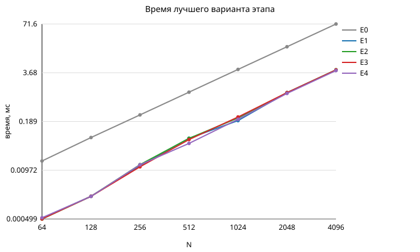
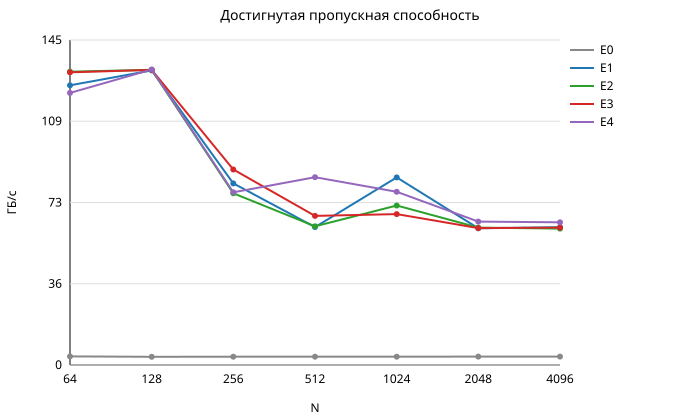

# ДЗ №1. Освоение векторизации

Вариант 3: сложение и вычитание плотных матриц больших размерностей.

## 1. Постановка задачи

Даны плотные матрицы A и B размера N x N типа `float`, хранение построчно.
Нужно вычислить

```
C[i][j] = A[i][j] + B[i][j]
D[i][j] = A[i][j] - B[i][j]
```

Арифметики здесь 2N^2 операций, а данных 4N^2 * 4 байт (A, B, C, D), то есть
на каждую операцию приходится 8 байт трафика. Арифметическая интенсивность
0.125 FLOP/байт — задача ограничена памятью, а не вычислениями, и это сразу
задаёт методику: замеры сделаны не для одного N, а свипом по N от 64 до 4096.
При малых N все матрицы лежат в кэше, и векторизация видна в полную силу; при
больших данные идут из оперативной памяти, и любой вариант упирается в её
пропускную способность.

Этапы оптимизации:

- E0 — исходная наивная версия без оптимизации;
- E1 — тот же код, но с ключами компилятора;
- E2 — полуавтоматическая векторизация: директивы и мелкие правки кода;
- E3 — ручная векторизация на NEON-интринсиках;
- E4 — оптимизация трафика памяти (non-temporal store, префетч).

Дополнительно во всех вариантах сравниваются два способа посчитать C и D:
двумя отдельными проходами (`sep`) и одним слитым проходом (`fused`), в
котором A и B читаются один раз на оба результата.

## 2. Вычислительная система

| Параметр | Значение |
|---|---|
| Процессор | Apple M4 (AArch64), 10 ядер: 4 производительных + 6 энергоэффективных |
| Память | 16 ГБ LPDDR5X, унифицированная; пик по спецификации 120 ГБ/с |
| L1d (P-ядро) | 128 КиБ |
| L2 (P-кластер) | 16 МиБ |
| Строка кэша | 128 Б |
| ОС | macOS 15.7.4 (Darwin 24.6.0) |
| Компилятор | Apple clang 17.0.0, target arm64-apple-darwin24 |
| Векторное расширение | NEON (ASIMD), 128 бит = 4 float |

Полный вывод `sysctl` — в `results/env.txt`.

На arm64 нет ни SSE, ни AVX; SVE в обычном режиме у Apple M-серии недоступен,
поэтому самое позднее доступное здесь векторное расширение — NEON, 128 бит,
4 числа одинарной точности на регистр. Это и определяет ожидаемый предел
векторизации: 4x относительно скалярного кода, пока данные лежат в кэше.

Границы режимов по размеру (рабочий набор слитого прохода 4N^2 * 4 Б):

| N | Рабочий набор | Где лежит |
|---|---|---|
| 64 | 64 КиБ | L1d |
| 128 | 256 КиБ | L2 |
| 256 | 1 МиБ | L2 |
| 512 | 4 МиБ | L2 |
| 1024 | 16 МиБ | граница L2 |
| 2048 | 64 МиБ | DRAM |
| 4096 | 256 МиБ | DRAM |

## 3. Структура проекта и запуск

Исходный код и все результаты: <https://github.com/Progo111/parallel_computing>
(каталог `dz1/`; ядра — `dz1/src/kernel_e*.c`).

```
src/kernel_e0.c   ядро E0 и E1 (один и тот же текст, разные ключи)
src/kernel_e2.c   ядро E2 (директивы автовекторизатора)
src/kernel_e3.c   ядро E3 (NEON-интринсики)
src/kernel_e4.c   ядро E4 (NT-store + префетч)
src/bench.c       прогон, проверка корректности, вывод CSV
scripts/run.sh    сборка, замеры, таблицы, графики
scripts/table.py  таблицы из results/raw.csv
scripts/plot.py   графики
```

Каждый вариант — отдельный объектный файл: исходник может быть общим, а ключи
компиляции разные, имена функций разводятся через `-DKERNEL_TAG`. Так в одном
бинаре одновременно живут и версия, собранная с `-O0`, и версия с `-Ofast`.

```
./scripts/run.sh          # всё целиком: сборка, замеры, таблицы, графики
make && ./build/bench     # только замеры со значениями по умолчанию
make listings             # ассемблерные листинги в asm/
```

## 4. Методика замеров

- Время берётся `clock_gettime(CLOCK_MONOTONIC_RAW)`.
- Один замер — это `reps` повторов ядра подряд, время делится на `reps`.
  Число повторов подбирается по размеру матрицы (около 40 млн элементов на
  замер), чтобы замер был много длиннее разрешения таймера.
- Перед замерами делается прогон на прогрев, он не учитывается.
- Замер повторяется 13 раз, в отчёт идёт минимум (медиана тоже пишется в CSV):
  минимум — это прогон, которому меньше всех помешали посторонние процессы.
- Поток просит у планировщика класс `QOS_CLASS_USER_INTERACTIVE`, иначе macOS
  может увести его на энергоэффективное ядро и времена разъедутся в разы.
- Результат каждого варианта сравнивается с эталоном, посчитанным скалярно,
  через `memcmp` — то есть побитово.
- Трафик считается как полезные чтения и записи: 24N^2 байт для двух
  отдельных проходов (A и B читаются дважды) и 16N^2 байт для слитого.

Про шум: на средних N разброс между повторами внутри одного запуска доходит до
10%, а между независимыми запусками `run.sh` лучшее время одного и того же
варианта отличается до 25% (например, E4 при N = 512: 0.050 и 0.063 мс).
Поэтому разница вариантов меньше этой величины ничего не значит. Дальше в
выводах это учтено — существенными считаются только различия в разы либо
устойчивые по всем N.

## 5. Что сделано на каждом этапе

### E0 — базовая версия

Наивный двойной цикл с двумерной индексацией `a[i * n + j]`, без `restrict`,
без разворота и без директив. Собирается с `-O0 -fno-vectorize
-fno-slp-vectorize -fno-unroll-loops`, то есть компилятору запрещено делать
хоть что-то. Это опорная точка для всех ускорений.

### E1 — только ключи компилятора

Тот же файл, что и E0, собранный с `-O2`, `-O3 -funroll-loops` и
`-Ofast -funroll-loops`. Код не менялся ни на строчку — вся разница в ключах.
Компилятор сам векторизует внутренний цикл, но, поскольку `restrict` нет, он
обязан перед векторным циклом проверить, не перекрываются ли массивы, и
держать скалярную ветку на случай перекрытия.

### E2 — полуавтоматическая векторизация

Четыре правки, после которых вектор по-прежнему строит компилятор:

- `restrict` на всех указателях — проверки перекрытия исчезают;
- `__builtin_assume_aligned` на 128 байт — разрешены выровненные обращения;
- один линейный цикл по `n * n` вместо двойного `i`/`j`;
- `#pragma clang loop` с явной шириной вектора и глубиной интерливинга:

```c
#pragma clang loop vectorize(enable) vectorize_width(4) interleave_count(INTERLEAVE)
    for (size_t k = 0; k < body; ++k)
        pc[k] = pa[k] + pb[k];
```

Интерливинг перебирается ключом `-DINTERLEAVE=1|2|4|8`. Хвост `n * n % блок`
считается скалярно отдельным циклом, поэтому корректность сохраняется для
любого N, в том числе не кратного ширине вектора.

### E3 — ручная векторизация

Здесь вектор задан руками, автовекторизатору работать не над чем:

```c
for (int u = 0; u < UNROLL; ++u) va[u] = vld1q_f32(pa + k + 4u * u);
for (int u = 0; u < UNROLL; ++u) vb[u] = vld1q_f32(pb + k + 4u * u);
for (int u = 0; u < UNROLL; ++u) vs[u] = vaddq_f32(va[u], vb[u]);
for (int u = 0; u < UNROLL; ++u) vd[u] = vsubq_f32(va[u], vb[u]);
```

Сначала все загрузки, потом вся арифметика, потом все записи — так внутри
итерации нет цепочки зависимостей load -> add -> store, и соседние обращения
складываются в парные `ldp q` / `stp q`. Разворот перебирается ключом
`-DUNROLL=1|2|4|8` (от 4 до 32 элементов за итерацию).

### E4 — трафик памяти

База — вариант E3 с разворотом на 4 вектора, сверху два приёма.

Non-temporal store: запись идёт мимо кэша, строка приёмника не подтягивается
из памяти ради того, чтобы быть сразу же перезаписанной целиком, и не
вытесняет из кэша A и B. Инструкция `stnp` пишет пару регистров, поэтому
запись делается сразу для двух соседних векторов — иначе clang расщепляет
128-битное значение и выдаёт `stnp d` вместо `stnp q`:

```c
typedef real_t ntpair_t __attribute__((vector_size(32), aligned(4)));

static inline void nt_store_pair(real_t *p, float32x4_t lo, float32x4_t hi)
{
    ntpair_t v = __builtin_shufflevector(lo, hi, 0, 1, 2, 3, 4, 5, 6, 7);
    __builtin_nontemporal_store(v, (ntpair_t *)p);
}
```

Программный префетч потоков A и B на `PF_DIST` элементов вперёд,
`__builtin_prefetch(p, 0, 0)` (чтение, строку в кэше не оставлять). Перебраны
значения 0 (только NT-store), 256 и 1024 элемента.

## 6. Результаты

Полные таблицы — `results/tables.md`, сырые замеры — `results/raw.csv`.
В ячейке лучшее время этапа по всем его вариантам и режимам.

### Лучшее время этапа, мс

| Этап | N = 64 | N = 128 | N = 256 | N = 512 | N = 1024 | N = 2048 | N = 4096 |
|---|---|---|---|---|---|---|---|
| E0 | 0.0171 | 0.0714 | 0.2827 | 1.1295 | 4.5130 | 17.9413 | 71.5735 |
| E1 | 0.0005 | 0.0020 | 0.0129 | 0.0680 | 0.1999 | 1.0975 | 4.3545 |
| E2 | 0.0005 | 0.0020 | 0.0137 | 0.0676 | 0.2351 | 1.0912 | 4.3968 |
| E3 | 0.0005 | 0.0020 | 0.0120 | 0.0629 | 0.2484 | 1.0957 | 4.3679 |
| E4 | 0.0005 | 0.0020 | 0.0136 | 0.0499 | 0.2165 | 1.0458 | 4.2036 |

Все лучшие времена получены в режиме слитого прохода.

### Ускорение относительно E0

| Этап | N = 64 | N = 128 | N = 256 | N = 512 | N = 1024 | N = 2048 | N = 4096 |
|---|---|---|---|---|---|---|---|
| E1 | 32.7x | 35.9x | 21.9x | 16.6x | 22.6x | 16.3x | 16.4x |
| E2 | 34.2x | 36.0x | 20.7x | 16.7x | 19.2x | 16.4x | 16.3x |
| E3 | 34.2x | 35.9x | 23.6x | 18.0x | 18.2x | 16.4x | 16.4x |
| E4 | 31.8x | 36.0x | 20.8x | 22.6x | 20.8x | 17.2x | 17.0x |

### Достигнутая пропускная способность, ГБ/с

| Этап | N = 64 | N = 128 | N = 256 | N = 512 | N = 1024 | N = 2048 | N = 4096 |
|---|---|---|---|---|---|---|---|
| E0 | 3.8 | 3.7 | 3.7 | 3.7 | 3.7 | 3.7 | 3.8 |
| E1 | 125.2 | 131.8 | 81.3 | 61.7 | 83.9 | 61.1 | 61.6 |
| E2 | 131.2 | 132.1 | 76.8 | 62.0 | 71.4 | 61.5 | 61.0 |
| E3 | 130.9 | 132.0 | 87.5 | 66.7 | 67.5 | 61.2 | 61.5 |
| E4 | 121.7 | 132.2 | 77.3 | 84.0 | 77.5 | 64.2 | 63.9 |





Видно главное: весь выигрыш даёт переход E0 -> E1, дальше кривая ложится на
полку. На кэшируемых размерах это 130 ГБ/с, на DRAM-размерах — 61-64 ГБ/с,
и в эту полку упираются все векторные варианты независимо от того, кто строил
вектор — компилятор или мы.

### Подбор ключей, E1 (слитый проход, мс)

| Ключи | N = 64 | N = 256 | N = 512 | N = 1024 | N = 2048 | N = 4096 |
|---|---|---|---|---|---|---|
| `-O2` | 0.0006 | 0.0166 | 0.0682 | 0.2740 | 1.1257 | 4.3545 |
| `-O3 -funroll-loops` | 0.0005 | 0.0129 | 0.0709 | 0.2867 | 1.0975 | 4.3751 |
| `-Ofast -funroll-loops` | 0.0005 | 0.0139 | 0.0680 | 0.1999 | 1.1127 | 4.4512 |

Уровень оптимизации выше `-O2` уже ничего не добавляет: цикл векторизуется и
там, а `-Ofast` не может ускорить одну операцию на элемент, потому что
переассоциировать здесь нечего.

### Подбор интерливинга, E2 (слитый проход, мс)

| Интерливинг | N = 64 | N = 256 | N = 512 | N = 1024 | N = 2048 | N = 4096 |
|---|---|---|---|---|---|---|
| 1 | 0.0006 | 0.0137 | 0.0676 | 0.2351 | 1.0912 | 5.1104 |
| 2 | 0.0005 | 0.0141 | 0.0681 | 0.2469 | 1.0951 | 4.3968 |
| 4 | 0.0005 | 0.0154 | 0.0676 | 0.2519 | 1.1013 | 5.2529 |
| 8 | 0.0005 | 0.0173 | 0.0729 | 0.3101 | 1.3581 | 6.0131 |

### Подбор разворота, E3 (слитый проход, мс)

| Разворот | N = 64 | N = 256 | N = 512 | N = 1024 | N = 2048 | N = 4096 |
|---|---|---|---|---|---|---|
| 1 вектор | 0.0006 | 0.0156 | 0.0629 | 0.2587 | 1.3776 | 4.3679 |
| 2 вектора | 0.0005 | 0.0120 | 0.0644 | 0.2720 | 1.1134 | 4.5682 |
| 4 вектора | 0.0006 | 0.0140 | 0.0640 | 0.2484 | 1.0957 | 5.1850 |
| 8 векторов | 0.0005 | 0.0149 | 0.0739 | 0.2951 | 1.2781 | 5.8910 |

В обеих таблицах разворот и интерливинг сверх 2-4 векторов только вредят:
арифметики на элемент слишком мало, чтобы её было чем перекрывать, зато
растёт давление на регистры и объём хвоста. Разница между 1, 2 и 4 в
пределах шума, а 8 проигрывает устойчиво на всех N.

### Подбор дистанции префетча, E4 (слитый проход, мс)

| Дистанция | N = 64 | N = 256 | N = 512 | N = 1024 | N = 2048 | N = 4096 |
|---|---|---|---|---|---|---|
| без префетча | 0.0013 | 0.0137 | 0.0652 | 0.2249 | 1.0826 | 4.3338 |
| 256 элементов | 0.0013 | 0.0136 | 0.0499 | 0.2165 | 1.0458 | 4.2036 |
| 1024 элемента | 0.0005 | 0.0202 | 0.0616 | 0.2279 | 2.6976 | 12.9716 |

Префетч на 256 элементов (1 КиБ) вперёд даёт небольшой, но устойчивый выигрыш
на больших N: он попадает в окно, где аппаратный префетчер ещё не успел
подтянуть строку, а нам она уже нужна. Префетч на 1024 элемента, наоборот,
рушит производительность в 3 раза на DRAM-размерах: запросы уходят слишком
далеко вперёд, мешают аппаратному префетчеру и забивают очередь обращений к
памяти. Это единственный вариант во всей работе, который сделал заметно хуже.

Отдельно видно цену non-temporal store при N = 64: 0.0013 мс против 0.0005 у
E1-E3. Данные целиком лежат в L1, а запись мимо кэша лишает следующий прогон
уже прогретых строк. NT-store имеет смысл только тогда, когда результат
действительно не понадобится сразу, то есть на больших N.

### Раздельные проходы против слитого (лучшее время, мс)

| N | sep | fused | выигрыш |
|---|---|---|---|
| 64 | 0.0007 | 0.0005 | 1.48x |
| 256 | 0.0172 | 0.0120 | 1.44x |
| 512 | 0.0765 | 0.0499 | 1.53x |
| 1024 | 0.2978 | 0.1999 | 1.49x |
| 2048 | 1.5048 | 1.0458 | 1.44x |
| 4096 | 5.8049 | 4.2036 | 1.38x |

Это второй по величине выигрыш после самой векторизации, и он получен не
арифметикой, а трафиком: слитый проход читает A и B один раз вместо двух,
24N^2 байт превращаются в 16N^2, то есть 1.5x по модели. Измерено 1.38-1.53x,
что с моделью согласуется.

## 7. Ассемблерные листинги

Полные листинги по одному на этап — в `asm/`, собираются `make listings`.
Ниже горячие циклы слитого прохода.

E0, `-O0`. Один элемент за итерацию, каждый индекс пересчитывается заново,
все промежуточные значения гоняются через стек:

```asm
LBB2_4:
	ldr	x8, [sp, #56]
	ldr	x9, [sp, #16]
	ldr	x10, [sp, #24]
	mul	x9, x9, x10
	ldr	x10, [sp, #8]
	add	x9, x9, x10
	ldr	s0, [x8, x9, lsl #2]
	...
	fadd	s0, s0, s1
	...
	fsub	s0, s0, s1
```

E1, `-O3`. Цикл векторизован, но перед ним стоят пять проверок перекрытия
массивов, а на N < 8 есть отдельная скалярная ветка:

```asm
LBB2_11:
	sub	x8, x3, x2
	cmp	x8, #32
	b.lo	LBB2_21
	...
LBB2_19:
	ldp	q0, q1, [x17, #-16]
	ldp	q2, q3, [x15, #-16]
	fadd.4s	v4, v0, v2
	fadd.4s	v5, v1, v3
	stp	q4, q5, [x16, #-16]
	fsub.4s	v0, v0, v2
	fsub.4s	v1, v1, v3
	stp	q0, q1, [x0, #-16]
```

E2, `-O3` + `restrict` + директивы. Проверок перекрытия нет, цикл один
(линейный по `n * n`), за итерацию 16 элементов:

```asm
LBB2_2:
	ldp	q0, q1, [x13, #-32]
	ldp	q2, q3, [x13], #64
	ldp	q4, q5, [x14, #-32]
	ldp	q6, q7, [x14], #64
	fadd.4s	v16, v0, v4
	fadd.4s	v17, v1, v5
	fadd.4s	v18, v2, v6
	fadd.4s	v19, v3, v7
	stp	q16, q17, [x12, #-32]
	fsub.4s	v0, v0, v4
	...
```

E3, ручной NEON с разворотом на 4 вектора. Код практически совпадает с E2 —
это и есть главный результат сравнения этапов: на такой простой задаче
компилятор с подсказками пишет то же самое, что и человек руками.

```asm
LBB2_3:
	ldp	q0, q1, [x10, #-32]
	ldp	q2, q3, [x10], #64
	ldp	q4, q5, [x13, #-32]
	ldp	q6, q7, [x13], #64
	fadd.4s	v16, v0, v4
	...
	fsub.4s	v0, v0, v4
	...
	stp	q16, q17, [x11, #-32]
	stp	q0, q1, [x9, #-32]
```

Хвост в E2, E3 и E4 действительно скалярный, отдельным циклом после горячего:

```asm
LBB2_6:
	ldr	s0, [x12], #4
	ldr	s1, [x11], #4
	fadd	s2, s0, s1
	str	s2, [x10], #4
	fsub	s0, s0, s1
	str	s0, [x9], #4
```

E4. Запись идёт парной non-temporal инструкцией `stnp q`, то есть приём
действительно доехал до кода, а не остался в исходнике:

```asm
LBB2_3:
	ldp	q0, q1, [x11, #-32]
	ldp	q2, q3, [x11], #64
	ldp	q4, q5, [x12, #-32]
	ldp	q6, q7, [x12], #64
	fadd.4s	v16, v0, v4
	fadd.4s	v17, v1, v5
	stnp	q16, q17, [x10, #-32]
	...
	fsub.4s	v0, v0, v4
	fsub.4s	v1, v1, v5
	stnp	q0, q1, [x9, #-32]
```

Про выравнивание: на AArch64 нет отдельных «выровненных» векторных
инструкций вроде `movaps`/`movapd` — `ldr q` и `ldp q` работают с любым
адресом. Выигрыш от выравнивания проявляется иначе: буферы выделены по
границе страницы, поэтому векторное обращение никогда не пересекает строку
кэша, и компилятор не строит пролог довыравнивания.

## 8. Сравнение с теоретическим пределом

Считаем два предела и смотрим, какой из них ближе.

Предел по памяти. Слитому проходу нужно 16N^2 байт полезного трафика. При
N = 4096 это 268 МБ; за измеренные 4.204 мс получается 63.9 ГБ/с. Пик
подсистемы памяти M4 по спецификации — 120 ГБ/с на весь чип, то есть мы
выбираем 53% от него. Но 120 ГБ/с — это предел для всех десяти ядер сразу:
одно ядро ограничено числом одновременно висящих промахов и физически не
может забрать всю шину. Практический потолок одного потока виден прямо в
таблице: начиная с N = 2048 все векторные варианты дают 61-64 ГБ/с и
перестают отличаться друг от друга. Значит, на DRAM-размерах мы стоим ровно
на этом потолке, и дальше выигрыш даст только многопоточность.

Предел по арифметике. NEON даёт 4 fp32 на инструкцию; у P-ядра M4 несколько
векторных конвейеров на частоте около 4 ГГц, что дают десятки GFLOP/s. Нам же
при N = 4096 нужно всего 2N^2 / t = 33.6 МFLOP / 4.204 мс = 8 GFLOP/s, и даже
в самом быстром кэшируемом случае (N = 128, 0.0020 мс) — 16 GFLOP/s. То есть
арифметика загружена на десяток процентов, и это ожидаемо: одна операция на
16 байт трафика.

Отсюда и общий вид результатов. Ожидаемое от векторизации ускорение 4x честно
проявляется только там, где данные в кэше, — и именно там ускорение E0 -> E1
максимально (36x на N = 128: кроме векторизации, компилятор убрал ещё и
накладные расходы `-O0`). На DRAM-размерах любой векторный вариант упирается
в память, поэтому этапы E2, E3 и E4 отличаются единицами процентов, а
осмысленно выигрывают только те приёмы, которые уменьшают сам трафик: слияние
проходов (1.4-1.5x). Эффект NT-store с префетчем (единицы процентов в
одном запуске) лежит в пределах шума между запусками и надёжно не
воспроизводится.

## 9. Контроль корректности

Результат каждого варианта на каждом N сравнивается с эталоном, посчитанным
скалярно в `bench.c`, через `memcmp`, то есть побитово. Все 15 вариантов в
обоих режимах на всех семи размерах совпали с эталоном; программа печатает это
в конце прогона.

Побитового совпадения здесь можно требовать, потому что на каждый элемент
приходится ровно одна операция: ни переассоциации, ни изменения порядка
суммирования быть не может, и `-Ofast`/`-ffast-math` результат не меняют.
Матрицы заполняются значениями из [1, 2) — без нулей, денормалов и
переполнений, чтобы совпадение было содержательным, а не случайным.

Хвостовые циклы проверяются автоматически: N = 1023 даёт `n * n = 1046529`,
что не кратно ни 4, ни 16, и такой прогон (`--sizes 1023`) тоже проходит
побитово.

## 10. Выводы

1. Задача `C = A + B`, `D = A - B` ограничена памятью: 0.125 FLOP на байт.
   Поэтому осмысленный результат даёт не одно число, а свип по N — только так
   видно, где векторизация работает, а где упёрлись в шину.
2. Основное ускорение (16-36x) даёт переход от `-O0` к обычным ключам
   оптимизации: компилятор сам векторизует такой цикл, и не воспользоваться
   этим было бы странно. Между `-O2`, `-O3` и `-Ofast` разницы почти нет.
3. Полуавтоматическая и ручная векторизация дали тот же ассемблер, что и
   `-O3` с `restrict`: парные `ldp q`/`stp q`, 4 сложения и 4 вычитания за
   итерацию. Выигрыша по времени они не дали, зато сняли рантайм-проверки
   перекрытия и сделали код предсказуемым.
4. Что действительно помогло на больших матрицах — уменьшение трафика:
   слияние двух проходов в один (1.4-1.5x). Non-temporal store с префетчем
   на 256 элементов дал единицы процентов, что в пределах шума между
   запусками, поэтому как улучшение его засчитывать нельзя. Приёмы,
   работающие с арифметикой, а не с памятью, не дали ничего.
5. Глубокий разворот и далёкий префетч вредны: разворот на 8 векторов
   устойчиво медленнее, а префетч на 1024 элемента замедляет DRAM-режим в
   3 раза.
6. На N >= 2048 все векторные варианты дают 61-64 ГБ/с — это потолок одного
   ядра (53% от пика чипа 120 ГБ/с). Дальше ускорять однопоточный код смысла
   нет, следующий шаг — распараллеливание по ядрам.
